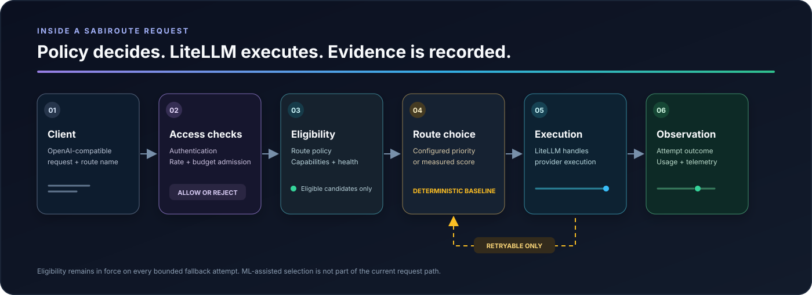

# SabiRoute Core v1 — Batch 2 release candidate

SabiRoute is a context-aware, health-aware AI gateway. This tree is the
**Batch 2 core candidate**: a core-only release containing the runtime
dependency closure, the tests and fixtures they need, reproducible build
metadata, configuration inputs, the CI workflow, and the operator
documentation for the core surface.

## Scope of this candidate

Included: the gateway, deterministic and capability-aware routing, provider
capability declarations, the API-key and admin surfaces, the PostgreSQL key
store, the Redis-backed rate limiter, and the health and readiness endpoints.

Deliberately **not** part of this core candidate:

- the SabiChat product surface — this candidate exposes no `/v1/auth/*` or
  `/v1/conversations/*` route;
- the `web/` static UI and its `/app` mount — this candidate serves no `/app`
  route. `tests/test_deployment.py::test_app_route_not_served_by_core`
  asserts that absence.

The full-project README, including the product surface, is maintained
separately on the `main` branch. It is not modified by, and not required by,
this candidate.

## Request path



A request enters at the API, passes access checks and authentication, is
classified against deployment capabilities, is filtered for health, and is
scored deterministically. Only then is a provider call attempted; the outcome
is observed and recorded.

## HTTP surface

Public — no credential required:

| Method | Path | Purpose |
| --- | --- | --- |
| GET | `/health` | Aggregate component status |
| GET | `/health/live` | Dependency-free liveness probe |
| GET | `/health/ready` | Readiness; returns `503` when a component is not ok |

Client API key — `Authorization: Bearer <client key>`:

| Method | Path | Purpose |
| --- | --- | --- |
| POST | `/v1/chat/completions` | OpenAI-compatible chat completions, routed by the configured policy |

Administrative — `Authorization: Bearer <SABIROUTE_ADMIN_KEY>`:

| Method | Path | Purpose |
| --- | --- | --- |
| GET | `/admin/health`, `/admin/metrics`, `/admin/latency`, `/admin/errors`, `/admin/usage` | Operational read models |
| POST | `/admin/api-keys` | Create a client key; the secret is returned once |
| POST | `/admin/api-keys/{key_id}/rotate` | Revoke and replace a client key |
| POST | `/admin/api-keys/{key_id}/revoke` | Revoke a client key |
| GET, PUT, DELETE | `/admin/api-keys/{key_id}/rate-limit` | Read, set or clear a per-key limit |
| GET, PUT | `/admin/shared-inference` | Read or change the shared-inference policy |

`/docs`, `/redoc` and `/openapi.json` are **disabled by default**. They are
served only when `SABIROUTE_DOCS_ENABLED` is set to a truthy value
(`1`, `true`, `yes`, `on`). See [docs/security.md](docs/security.md).

## Request limits

| Limit | Value | Override |
| --- | --- | --- |
| Request body | 1 MiB (1,048,576 bytes) | `SABIROUTE_MAX_REQUEST_BODY_BYTES`, ceiling 16 MiB |
| Messages per request | 256 | not configurable |
| Characters per message | 500,000 | not configurable |

A body over the limit is rejected with `413` before the request is parsed.

## Configuration

Runtime configuration is read from the environment; file-based configuration is
pointed at by `SABIROUTE_CONFIG_PATH` and `SABIROUTE_ROUTES_PATH`.

- [`.env.example`](.env.example) — the environment variable template. It
  contains no secret values.
- [`config/config.yaml`](config/config.yaml) — deployments, capabilities,
  pricing and scoring policy.
- `config/routes/*.yaml` — per-route policy.

Keys used by this candidate include `DATABASE_URL`, `REDIS_URL` (or
`REDIS_HOST`/`REDIS_PORT`/`REDIS_PASSWORD`), `SABIROUTE_ADMIN_KEY`,
`SABIROUTE_HOST`, `SABIROUTE_API_PORT`, `SABIROUTE_DOCS_ENABLED` and
`SABIROUTE_MAX_REQUEST_BODY_BYTES`. `LITELLM_MASTER_KEY` is the internal
SabiRoute-to-LiteLLM credential and must not be reused as an admin or client
key.

## Running

Host-run:

```bash
uv sync --frozen
uv run sabiroute
```

The process binds `SABIROUTE_HOST` (default `127.0.0.1`) on
`SABIROUTE_API_PORT` (default `8000`). A wheel install relocates the package
away from repository-relative paths, so set `SABIROUTE_CONFIG_PATH` and
`SABIROUTE_ROUTES_PATH` to absolute paths.

Container stack — [`docker-compose.yml`](docker-compose.yml) defines four
services, `litellm`, `sabiroute`, `postgres` and `redis`, each published on
loopback only, with the application image built from the
[`Dockerfile`](Dockerfile):

```bash
docker compose up --build
```

The `sabiroute` service overrides `DATABASE_URL` and the `REDIS_*` addresses
to the Compose service names, because those names resolve only on the Compose
network. See [docs/deployment.md](docs/deployment.md).

## Tests and CI

The repository's own suite is the gate:

```bash
uv run pytest -q
uv run ruff check src tests scripts config
uv run mypy src
```

The hosted workflow [`.github/workflows/ci.yml`](.github/workflows/ci.yml)
runs the suite with PostgreSQL and Redis services declared, then Ruff, Mypy
and a container build. It must be green on the exact commit that is released.

## Documentation

| Document | Contents |
| --- | --- |
| [docs/deployment.md](docs/deployment.md) | Runtime topology, configuration, application container, managed PostgreSQL, startup and rollback |
| [docs/security.md](docs/security.md) | Authentication boundary, key lifecycle, documentation-exposure policy, rate-limit topology |
| [docs/routing.md](docs/routing.md) | Virtual models, routing policies, provider-health decision |
| [docs/routing-scoring.md](docs/routing-scoring.md) | The deterministic measured-rank scorer |
| [docs/capabilities.md](docs/capabilities.md) | Typed capability declarations and request classification |
| [docs/providers.md](docs/providers.md) | Provider registry, capabilities and pricing |
| [docs/limits-and-usage.md](docs/limits-and-usage.md) | Quotas, limits and usage reporting |
| [docs/proxy-retry-visibility.md](docs/proxy-retry-visibility.md) | How hidden LiteLLM proxy retries affect SabiRoute |
| [docs/phase13-data-foundation.md](docs/phase13-data-foundation.md) | The routing data foundation and its read-only audit tooling |

## What this candidate does not establish

This tree is a release candidate, not a production release. The following are
**not** established by the code and tests in this tree:

- live-provider behaviour; no provider call is made by the test suite;
- end-to-end enforcement of a per-key rate limit over the HTTP request path —
  the Redis token bucket's admit and deny behaviour is exercised at component
  level, and the limiter is consulted only for keys that have a limit row;
- transport encryption — the repository does not configure TLS, and SCRAM
  authentication is not transport encryption;
- staging, managed-PostgreSQL or production deployment.

## Licence

[MIT](LICENSE).
