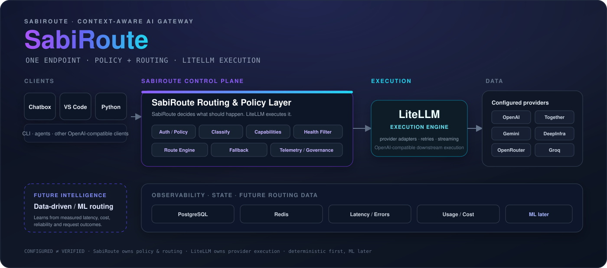
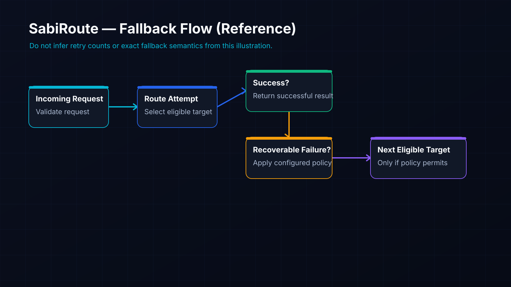
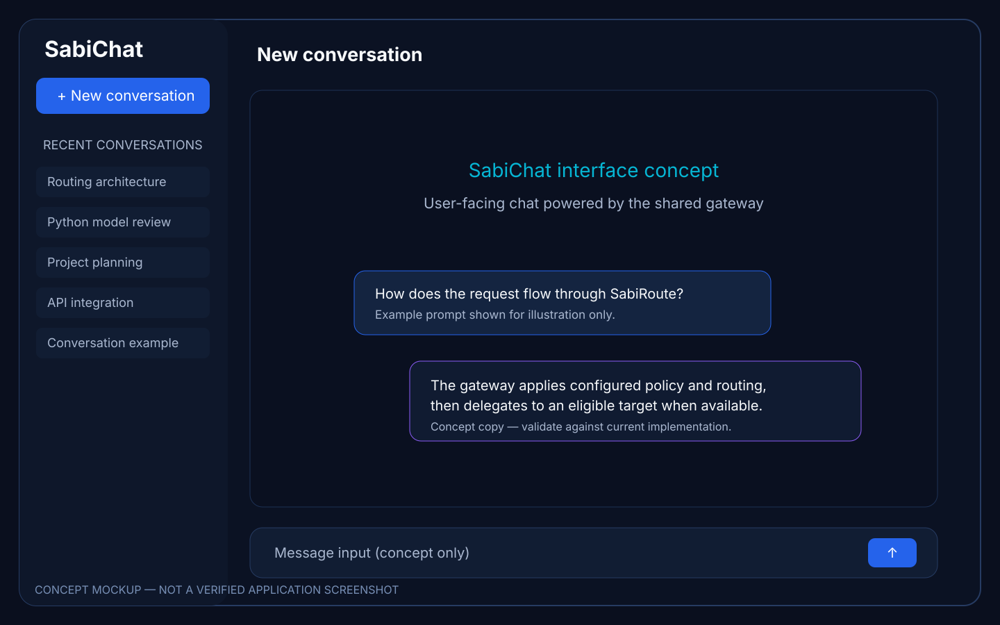
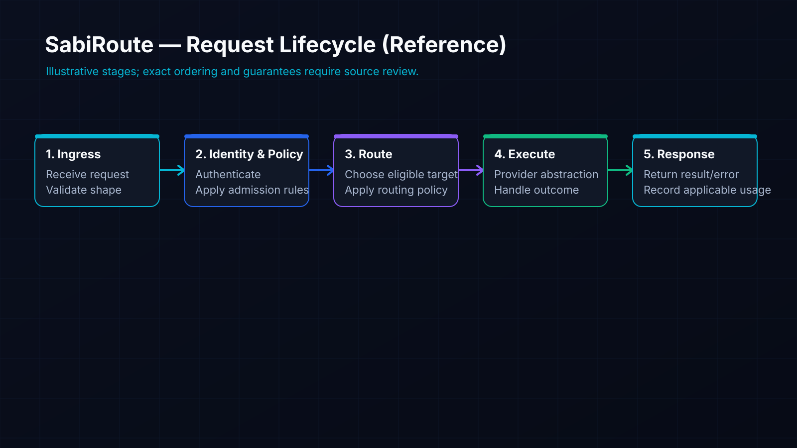
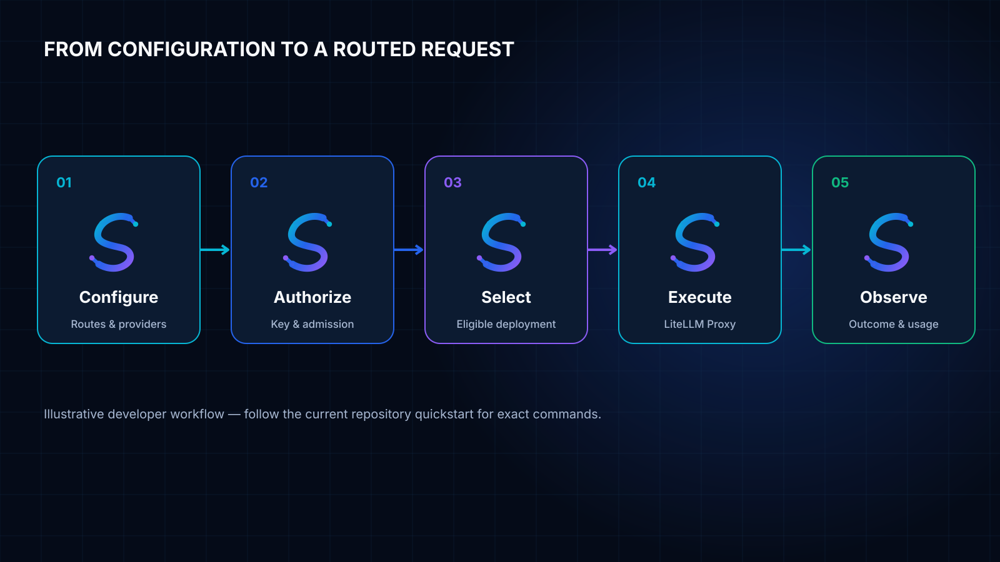

<div align="center">



<br/>

[](https://git.io/typing-svg)

[](https://github.com/yourfavCHEFP/SabiRoute/blob/feat/sabiroute-routing-foundation/pyproject.toml)
[](https://www.python.org/)
[](https://github.com/BerriAI/litellm)
[](./LICENSE)


**One gateway. Multiple providers. Deterministic, health-aware routing.**

[Architecture](#️-architecture) · [Routing](#-routing-intelligence) · [Providers](#-provider-strategy) · [Roadmap](#️-engineering-roadmap) · [Getting started](#-getting-started) · [Code of Conduct](#code-of-conduct) · [Contributing](#-contributing) · [Security](#security) · [MIT License](#-license)

</div>

---

# SabiRoute

### The context-aware, health-aware AI gateway for developers

SabiRoute is an open-source, self-hosted, local-first AI gateway that gives applications **one OpenAI-compatible endpoint across multiple model providers**. It sits between clients — Chatbox, IDEs, Python applications, CLI tools, ML projects, and coding agents — and the providers they call, and decides centrally how each request should be routed.

SabiRoute owns the decision layer:

- routing policy and request classification;
- explicit capability and health eligibility;
- deterministic candidate selection and fallback;
- authentication, budgets, and rate limits on the real request path;
- latency, reliability, and usage telemetry;
- measured routing — and, only when justified by evidence, future ML-assisted selection.

> **SabiRoute is not another LiteLLM wrapper.**
>
> LiteLLM is the current provider-execution engine.
> **SabiRoute is the control, routing, intelligence, and governance layer built around it.**

> **"Sabi"** — Nigerian Pidgin for "to know" or "to be skilled at."
>
> A gateway that knows which model should handle a request, so the developer does not have to.

SabiRoute is in active alpha development (package version `0.1.0`). The deterministic routing foundation is implemented and progressively verified; ML-assisted routing is a gated future layer, not a current feature. Status below distinguishes implementation, tests, and documented runtime evidence.

## Contents

- [SabiRoute](#sabiroute)
    - [The context-aware, health-aware AI gateway for developers](#the-context-aware-health-aware-ai-gateway-for-developers)
  - [Contents](#contents)
  - [🎯 Why SabiRoute?](#-why-sabiroute)
  - [✨ Core capabilities and direction](#-core-capabilities-and-direction)
    - [🧠 Context-aware routing](#-context-aware-routing)
    - [🛡️ Health-aware fallback](#️-health-aware-fallback)
    - [🧩 Virtual model policies](#-virtual-model-policies)
    - [🔐 Governance on the request path](#-governance-on-the-request-path)
    - [💬 SabiChat](#-sabichat)
    - [📊 Observability](#-observability)
    - [🤖 Future ML-assisted routing](#-future-ml-assisted-routing)
  - [🏗️ Architecture](#️-architecture)
    - [Responsibility boundary](#responsibility-boundary)
    - [Request flow](#request-flow)
  - [🧠 Routing intelligence](#-routing-intelligence)
  - [🌐 Provider strategy](#-provider-strategy)
  - [🛣️ Engineering roadmap](#️-engineering-roadmap)
  - [📊 ML readiness status (Phase 13)](#-ml-readiness-status-phase-13)
  - [🚀 Getting started](#-getting-started)
    - [API usage](#api-usage)
  - [🧪 Testing and validation](#-testing-and-validation)
  - [🔬 What makes this an ML systems project?](#-what-makes-this-an-ml-systems-project)
  - [⚠️ Known limitations](#️-known-limitations)
  - [Code of Conduct](#code-of-conduct)
  - [🤝 Contributing](#-contributing)
  - [Security](#security)
  - [🆓 Free Pool](#-free-pool)
    - [What is Free Pool?](#what-is-free-pool)
    - [One platform, three experiences, one routing foundation](#one-platform-three-experiences-one-routing-foundation)
    - [Catalogue, registry, router: three distinct concepts](#catalogue-registry-router-three-distinct-concepts)
    - [Free access, stated accurately](#free-access-stated-accurately)
    - [Current versus future](#current-versus-future)
    - [Runtime enforcement status](#runtime-enforcement-status)
    - [Fit with the existing roadmap](#fit-with-the-existing-roadmap)
  - [🌍 Long-term direction](#-long-term-direction)
  - [📄 License](#-license)
  - [👤 Author](#-author)

---

## 🎯 Why SabiRoute?

Modern AI applications depend on multiple model providers. One model is faster, another cheaper, another better at reasoning or coding or long context — and any of them can simply be unavailable.

The problem is not only:

> "How do I call an LLM?"

The more interesting systems problem is:

> **"How do I decide which available deployment should handle this particular request, while remaining reliable when providers fail?"**

SabiRoute is being built around that question. The goal is a system where applications talk to one stable endpoint while measured, explainable routing decisions happen underneath — based on real constraints and evidence, not provider marketing claims.

---

## ✨ Core capabilities and direction

### 🧠 Context-aware routing

Workload classes narrow the candidate pool before selection:

| Request type | Primary bias |
|---|---|
| `inline_completion` | Latency |
| `chat` | Quality and context |
| `coding_agent` | Reasoning and tool capability |

Classes come from explicit request metadata and route requirements — prompt wording is never treated as evidence of a coding or reasoning task. Capability-aware filtering is the approved design ([docs/capabilities.md](docs/capabilities.md) carries the classification rules and evidence matrix from the newer line), but this checkout's `choose_deployment` filters only on prior attempts and health availability — there is no `sabi_route_request_type` handling or capability-metadata filtering in the candidate tree. Re-verify before relying on it.

### 🛡️ Health-aware fallback

A provider failure becomes a controlled routing event, not an application outage. Unhealthy deployments are excluded from the eligible pool, deterministic fallback tries the next eligible candidate, and cooldown lets failed deployments recover. Retryable failures (eligible 429/5xx responses, timeouts, connection failures) are distinguished from errors that must not be blindly retried. Fallback and cooldown recovery are implemented and unit-tested (Phases 05–06); the failure paths have not been exercised against live providers, and the former active `ProviderHealthChecker` was removed after verification that nothing referenced it — it was never wired into the request path. On this branch the bounded-fallback loop lives in the completions request path (`src/sabiroute/api/completions.py`), which selects each attempt through `Router.choose_deployment` with `FallbackEngine` (`routing/fallback.py`) as the router's default fallback handler (see `docs/proxy-retry-visibility.md`).



*Reference illustration — retry counts and exact fallback semantics are defined by code and `docs/proxy-retry-visibility.md`, not by this diagram.*


*Illustrative animation loop — a conceptual visualization, not a recording of live traffic. Static frame: `08-motion-and-gifs/frames/bounded-fallback/bounded-fallback-frame-01.png`.*

### 🧩 Virtual model policies

Clients request a virtual route instead of hard-coding provider/model pairs — `ultimate`, `coding`, `research`, `reasoning`, `fast`, or `cheap`. (`SabiRoute_Research`-style names resolve to the same policies, case-insensitively.) The underlying deployments can change without touching every client configuration. Route files are validated at startup; unknown aliases or invalid candidates fail loudly instead of silently routing everywhere. See [docs/routing.md](docs/routing.md).

### 🔐 Governance on the request path

**Planned governance (not implemented on this branch):** API-key lifecycle with create/rotate/revoke, an admin bootstrap credential, per-key token-bucket rate limits, and per-key token/cost budgets are the approved Phase 09–10 design, but the candidate tree contains no key store, no budget/rate-limit enforcement, and no `/admin/api-keys` management endpoints — `src/sabiroute/api/admin.py` exposes read-only telemetry (`/admin/health|metrics|latency|errors|usage`) only. Do not present key issuance, SHA-256 digest storage, Redis-backed limits, or transactional budget reservation as current behavior; re-verify each against the implementation before relying on it.

Details of the approved design: [docs/security.md](docs/security.md), [docs/limits-and-usage.md](docs/limits-and-usage.md).

### 💬 SabiChat

**Planned chat experience (not implemented on this branch):** a user-facing chat over the same gateway — not a second router — is the approved design, but the candidate tree contains no chat backend (`src/sabiroute/chat/` absent), no auth/conversation/quota endpoints, no `web/` UI, and no `tests/test_sabichat_web.py`. The endpoint list, session/token mechanics, pagination/message caps, and in-process gateway-call design described below are **forward-looking specifications carried over from newer working-tree documentation**, not current behavior; do not present registration, login, conversations, quota summaries, or the browser UI as implemented. Re-verify each against the implementation before relying on it.

Approved design (planned, not current):

- `POST /v1/auth/register|login|logout`, `GET /v1/auth/me`, `GET /v1/chat/quota-summary` (session-authenticated; quota owner comes only from the validated session) — PBKDF2-hashed passwords (never plaintext), opaque bearer sessions (digest-only storage, 7-day expiry, logout revocation), generic failures that do not reveal whether an account exists, per-IP sign-in rate limits on register/login (generic `Too many attempts` responses);
- `POST|GET /v1/conversations`, `GET|POST /v1/conversations/{id}[/messages]` — every read and write is owner-scoped (another user's ID looks identical to a nonexistent one), bounded pagination (default page of 20, max 50), message size caps (8,000 chars per message, 120-char titles);
- chat invokes the gateway's own `POST /v1/chat/completions` in process with a server-held service key, forcing Free Chat mode itself — policy, budgets, Free Pool eligibility, and usage accounting apply unchanged, and gateway errors map to fixed public messages. A client-supplied Free Chat marker is ignored; only the server-held marker takes effect.



*Concept mockup — an illustration of the planned experience, not a screenshot of the running application (the file itself carries this label). No browser UI ships on this branch.*

The planned UI keeps the session token in memory only (reload signs out), renders model output as text, guards double submits, and maps expiry/rate-limit/eligibility failures to clear states. Interim limits: one service key held only in memory (a restart re-mints it; old rows are retained), in-process rate limits (single-process semantics), history window of 20 messages with a fixed response cap (`GATEWAY_MAX_TOKENS = 1024`). No BYOK, no billing — those are later phases. All of this paragraph describes the approved future design, not this checkout.

### 📊 Observability

The gateway tracks latency, success/failure, provider/deployment, token usage (as reported by the provider response; no estimator), error category, and routing decisions via in-memory trackers (`routing/health.py`, `monitoring/*`) exposed as read-only admin telemetry — no durable historical persistence and no cost calculation. On restart, signals reset; estimated and provider-reported tokens, where both exist, are kept separate only at read time.


*Illustrative animation loop — a conceptual visualization, not a live telemetry dashboard. Static frame: `08-motion-and-gifs/frames/observability-pulse/observability-pulse-frame-01.png`.*



*Reference illustration — exact ordering and guarantees are defined by `src/sabiroute/api/completions.py` and the request-path section below.*

### 🤖 Future ML-assisted routing

Machine learning is a later, gated stage — never a substitute for safe deterministic routing:

```text
Explicit eligibility and deterministic routing
                    ↓
          Measured routing signals
                    ↓
     Trustworthy, time-aware telemetry
                    ↓
       Dataset and evaluation checks
                    ↓
       Training only when justified
                    ↓
     Guarded inference and integration
                    ↓
       Benchmark against the baseline
```

An ML selector may only choose among deployments already deemed eligible. It must never bypass authentication, budgets, capabilities, health exclusions, or policy constraints — and if it fails, the deterministic path remains.

---

## 🏗️ Architecture

### Responsibility boundary

```text
                    Clients
        (Chatbox · IDEs · CLIs · apps · agents)
                       │
                       ▼
              ┌─────────────────┐
              │   SabiRoute API │◄──────────── PostgreSQL: keys, usage,
              ├─────────────────┤◄────────────   budgets, routing decisions
              │ Authentication  │
              │ Budgets & rate  │◄──────────── Redis: rate-limit buckets,
              │ Classification  │◄────────────   fast state
              │ Capability and  │
              │   health filters│
              │ Routing score   │
              │ Fallback        │
              └────────┬────────┘
                       ▼
             LiteLLM execution layer
                       │
        ┌──────────────┼──────────────┐
        ▼              ▼              ▼
     Gemini         Groq        OpenRouter · …
```

The boundary is intentional:

- **SabiRoute** owns eligibility, policy, routing, health constraints, governance, and routing telemetry.
- **LiteLLM** owns provider execution, provider adapters, and streaming mechanics.

SabiRoute decides which deployment should be attempted; LiteLLM executes the provider request.

### Request flow


*Illustrative animation loop — a conceptual visualization of the stages above, not a recording of live traffic. Static frame: `08-motion-and-gifs/frames/route-flow-frame-01.png`.*

The intended request path (planned architecture — not all stages exist on this branch; steps marked **planned** below have no implementation here):

1. Receive the client request.
2. **Planned:** authenticate and authorize it (client key / admin key boundary — no key store on this branch).
3. **Planned:** apply rate-limit and budget admission checks (no limiter/budget enforcement on this branch).
4. **Planned:** classify the request and establish required capabilities (no `sabi_route_request_type` / capability filtering in this tree).
5. Discover candidate deployments from the route policy.
6. Exclude candidates that fail health or policy requirements (**capability filtering planned**, not implemented).
7. Select among eligible candidates (configured priority; **measured scoring is planned**, not implemented).
8. Execute through LiteLLM.
9. On retryable failure, fall back per the retry and eligibility rules.
10. Normalize the response and record operational telemetry (in-memory; see observability note).

Free Chat requests (the planned SabiChat mode) would pass an additional explicit-allowlist gate between steps 6 and 7: only mapped deployments stay eligible, fallback cannot leave the allowlist, and denials happen before execution with stable reasons. The planned SabiChat backend would traverse this same numbered path in process — a client of the gateway, not a parallel router. Neither the Free Chat gate nor the SabiChat backend exists on this branch.

The stages above are represented in code and automated tests. The documented live-path evidence covers successful requests; provider failure, fallback, budget exhaustion, and rate-limit rejection have not been live-verified against real services. See the [roadmap](#️-engineering-roadmap) and [known limitations](#️-known-limitations). ML scoring is deliberately absent from this flow — it is a future, gated addition. The authoritative architecture record, roadmap milestones, and production gates live in [docs/architecture-decision-record.md](docs/architecture-decision-record.md).

---

## 🧠 Routing intelligence

Routing intelligence is built in layers, each resting on a trustworthy one below it.

**Layer 1 — Deterministic routing.** Configured policy and priority, healthy candidates, bounded fallback. Verified and the operational baseline.

**Layer 2 — Capability-aware routing (planned, not implemented on this branch).** The approved design makes required capabilities explicit filters before selection, with unknown values never counting as confirmed support and nothing inferred from provider or model names — but the candidate tree has no capability filtering in `choose_deployment` and the `intelligence/` modules are empty placeholders. Treat the design and the Phase 11 note as specification, not current behavior.

**Layer 3 — Measured deterministic scoring (planned, not implemented on this branch).** The approved design establishes the baseline formula `score = 0.7 * success_rate + 0.3 * latency_normalized` (`deterministic-v1`, weights in `config/config.yaml`), with fallback to configured route order on cold start, missing, or stale signals — but the candidate tree contains no scoring weights in config and no scorer implementation (`intelligence/scorer.py` is an empty placeholder). Treat the formula and the [docs/routing-scoring.md](docs/routing-scoring.md) semantics as the approved specification, not current behavior.

**Layer 4 — ML-assisted routing (future, gated).** The first target is attempt-level operational success. Every executed provider attempt must have its own observed outcome — a logical request that fell back contains several attempts, and they are not all labeled by the final result. Hard constraints on the data:

- HTTP success is an operational outcome, not answer quality.
- An unselected deployment has no observed outcome; no counterfactual labels are invented.
- API-level failures before provider execution are not fabricated into provider-attempt failures.
- Timeout labels are not inferred from generic transport errors.
- Cost values, quality labels, and counterfactual outcomes are never invented.
- Observational data is selection-biased; training requires trustworthy pairing, temporal provenance, outcome variation, coverage, and a defensible chronological evaluation design.

The model must never override capability, health, security, budget, or policy constraints.

---

## 🌐 Provider strategy

`config/config.yaml` is the runtime deployment catalog for both SabiRoute and LiteLLM. Fourteen aliases are configured across providers such as OpenAI, Google Gemini, Groq, Together AI, DeepInfra, Moonshot/Kimi, MiniMax, Cloudflare Workers AI, OpenRouter, Hugging Face, Cerebras, NVIDIA NIM, Cohere, and Pollinations AI. The full alias → model → credential table lives in [docs/providers.md](docs/providers.md).

Runtime evidence is deployment-specific and deliberately narrow — **on the newer working-tree line, not this checkout.** The table below records newer-line observations, preserved for continuity; the candidate tree has no live-provider verification harness output and no exercised request path to cite. Do not present these rows as observations of this branch.

| Deployment | Reported capabilities (newer line) | Reported evidence (newer line) |
|---|---|---|
| `sabiroute-gemini` | `chat` | Non-empty text completion through SabiRoute → LiteLLM |
| `sabiroute-groq` | `chat`, `streaming` | Non-empty completion and incremental SSE chunks end to end |
| `sabiroute-openrouter` | `chat` | Non-empty text completion through the configured OpenRouter deployment |

All other configured deployments remain **configured but unverified** on either line. Capability matrix (newer-line design): [docs/capabilities.md](docs/capabilities.md).


*Illustrative animation loop — deployment layout is conceptual, not a live provider-status view. Static frame: `08-motion-and-gifs/frames/provider-network/provider-network-frame-01.png`.*

> **Configured ≠ operational.** A provider appearing in configuration proves only that the alias and credential reference exist. A deployment becomes operational after: configuration → credentials → provider access → health test → real request → streaming test → fallback test.

Planned expansion may include DeepSeek, Mistral, xAI, and Ollama. Never put credential values in YAML, reports, or terminal output.

---

## 🛣️ Engineering roadmap

> **Code exists ≠ feature works.** A phase is complete only with implementation + tests + integration + real execution + failure validation. A unit-test pass is evidence — but it does not prove live provider behavior or production readiness.

**Legend:** **Complete** — implemented, tested, and exercised on a documented live path · **Implemented** — code and tests exist, required verification incomplete · **In progress** — active work, scope remains · **Blocked** — waiting on a data, evaluation, or dependency gate · **Planned** — not started

> **Branch-status scope note:** the phase table below is carried over from newer working-tree documentation. On this branch (`5044ef6`) the test suite is limited to `test_admin/completions/health/loader/registry/router` (no capability, scoring, Phase 10, SabiChat, dataset, or Redis-integration tests exist here), several referenced scripts (`audit_routing_dataset.py`, `verify_postgres.py`, `verify_phase10.py`, `benchmark_routing.py`) and `web/` are absent, and there has been no CI workflow. Treat every status above `Implemented` and every "exercised on the documented live run" statement as a **forward-looking claim from the newer line, not a verified fact about this checkout** — re-verify each phase against the implementation actually present before relying on it.

| Phase | Focus | Status | Evidence / notes |
|---:|---|---|---|
| 00 | Architecture and environment | Complete | Typed configuration and validation, app factory; full suite green |
| 01 | Basic LiteLLM gateway | Complete | Non-streaming and streaming requests documented on the live path; fallback covered by tests only |
| 02 | Provider expansion | Partial (design-stage) | Fourteen aliases are declared in `config/config.yaml`, but capability evidence wiring and live verification belong to the newer line — no verified deployments on this branch |
| 03 | Model registry | Complete | Registry and aliases in place; `config/config.yaml` is the runtime catalog |
| 04 | Virtual models / policies | Partial (design-stage) | `routing/policies.py` defines `max_attempts`/`strategy` policy shapes, but `config/routes/*.yaml` are zero-byte placeholders on this branch — no loadable route policies exist here |
| 05 | Fallback engine | Implemented (unit-tested on this branch) | Retry loop in the completions request path via `Router.choose_deployment` with `FallbackEngine` (`routing/fallback.py`) as default handler; covered by `test_router`/`test_completions`/`test_health`; no live failure-injection evidence; see [limitations](#️-known-limitations) |
| 06 | Health monitoring | Implemented (unit-tested on this branch) | Passive cooldown and recovery (`test_health`: trip, half-open reset, success reset); the former active `ProviderHealthChecker` was removed (see `docs/routing.md`) |
| 07 | Observability | Implemented (unit-tested on this branch) | Trackers wired into gateway state and admin endpoints; no stored failure-metric evidence |
| 08 | PostgreSQL | Planned | No `PostgresApiKeyStore` or PostgreSQL-backed store exists on this branch — persistence is file-local (see persistence limitation) |
| 09 | Authentication and API keys | Planned | No key lifecycle, admin-key boundary, or SHA-256 digest store exists on this branch |
| 10 | Budgets and rate limits | Planned | No budget or rate-limit enforcement exists on this branch |
| 11 | Capability-aware deterministic routing | Partial (design-stage) | Routing selects via `choose_deployment` with capability/health filtering intent, but `intelligence/` modules are empty placeholders and capability evidence is not wired — treat as planned |
| 12 | Measured deterministic scoring | Planned | No scoring weights in config and no scorer implementation on this branch (see Layer 3 note) |
| 13 | ML-assisted routing | Planned | No dataset, training, or inference exists on this branch — see [below](#-ml-readiness-status-phase-13) |
| 14 | Benchmarking | Planned | Compare against the unchanged deterministic baseline |
| 15 | Admin dashboard | Planned | — |
| 16 | Private remote access / Tailscale | Planned | — |
| 17 | Security hardening | Planned | Baseline controls maintained throughout earlier phases |
| 18 | Testing and regression | Planned | Tests are required throughout earlier phases |
| 19 | CI/CD | Planned | No workflow exists on this branch (`.github/` holds no workflows here); CI is approved future work |
| 20 | Production architecture | Planned | — |

Phase 11 note: unknown capabilities are never treated as verified support; capability evidence lives in `config/config.yaml` and [docs/capabilities.md](docs/capabilities.md) on the newer line. Phase 12 note: `scripts/benchmark_routing.py` (newer line only — absent here) runs a fixed synthetic comparison of `priority` vs `measured` — a methodology check, **not** proof of warm live-routing performance against real providers.

Cross-cutting workstreams (not phases — numbers, names, and gates above are unchanged): Free Pool runtime enforcement, usage attribution, the SabiChat backend (auth, sessions, conversations, gateway chat), and the SabiChat zero-build frontend (`web/`, served at `/app/`) are **approved future work carried over from newer working-tree documentation — none exists on this branch** (no `freepool/` or `chat/` packages, no chat endpoints, no `web/` UI, no SabiChat tests). Only catalogue mapping, quotas, and shared inference were ever gated behind Phase 20; the enforcement/backend/frontend items above are not gated — they are absent. None of this alters the Phase 13 training gates.

---

## 📊 ML readiness status (Phase 13)

Five status dimensions, kept deliberately separate:

| Dimension | Status |
|---|---|
| ML data-foundation implementation | **Planned — not present on this branch.** Schema `1.1` feature snapshots and a read-only audit tool exist on the newer working-tree line (commit `71271fc`) but the candidate tree has no dataset module, no snapshot schema, and no audit script |
| Live request-path verification | **Not applicable to this checkout** — the two bounded requests (`research` → OpenRouter; Groq streaming with `[DONE]`) were observed on the newer line, not here |
| Aggregate dataset integrity | **Not applicable** — no dataset exists on this branch to audit |
| Training readiness (13.3) | **Blocked** — necessarily so: with no dataset implementation present, there is nothing to train or evaluate |
| Commit isolation (2026-10-10) | Describes the newer feature-branch working tree, not this checkout |

The audit figures below (7 logical requests · 6 provider attempts · 5 feature snapshots · 6 labeled outcomes, no outcome variation, no usable chronological split) were recorded on the newer working-tree line and are preserved here for continuity — **they do not describe this checkout**, which has no dataset implementation and therefore no auditable telemetry. Do not present them as observations of this branch.

- ~~7 logical requests · 6 provider attempts · 5 feature snapshots · 6 labeled outcomes;~~ *(newer-line figures, not this checkout — see above)*
- ~~all six provider attempts successful → **no outcome variation**;~~ *(ditto)*
- ~~2 attempts with verified temporal provenance; 4 with unknown or unavailable provenance;~~ *(ditto)*
- ~~1 feature/outcome count mismatch; 1 outcome without a feature snapshot;~~ *(ditto)*
- ~~**no usable chronological evaluation split** (at least one attempt lacks a decision timestamp).~~ *(ditto)*

An earlier audit attempt was blocked by the execution environment (`Operation not permitted`); that was an environment access limitation, **not** a PostgreSQL outage. The historical unmatched observation has a successful provider outcome but no feature snapshot or attempt timestamps — it is left unrepaired on purpose. Do not fabricate timestamps or reconstructed features for it; a future training export must exclude it unless an authoritative original snapshot is recovered.

Phase status on this branch: **13.1–13.5 all planned, none implemented** — no data foundation, no target/label pipeline, no training, no guarded inference, no selector integration. **No model has been trained or deployed.** The phase vocabulary below (13.1 implemented · 13.2 in progress · 13.3+ blocked) describes the newer working-tree line, not this checkout — and training remains locked behind the same gates wherever it is eventually attempted.

Training stays locked until a fresh audit establishes sound feature/outcome pairing and temporal provenance, meaningful outcome variation, adequate coverage, and a leakage-safe chronological evaluation design — and even then, automated checks lead to human review, not automatic authorization to train. Observations should come from normal authorized traffic; never manufacture failures or randomize selection to grow the dataset. Details: [docs/phase13-data-foundation.md](docs/phase13-data-foundation.md).

---

## 🚀 Getting started

> **Local development setup.** Use `.env.example` as the environment template and keep `.env` local — never commit API keys, provider credentials, or database secrets.

**Prerequisites:** Python 3.11–3.13, [uv](https://docs.astral.sh/uv/), and Docker (for the Compose stack).

```bash
# 1. Install dependencies into .venv
uv sync

# 2. Configure the environment (fill in values locally)
cp .env.example .env

# 3. Start LiteLLM, PostgreSQL, and Redis
docker compose up -d

# 4. Run the gateway on the host (default 127.0.0.1:8000)
./.venv/bin/sabiroute
```

Key environment variables (names only — see `.env.example` for the full list; the candidate `.env.example` defines the LiteLLM, PostgreSQL, Redis, and provider-credential names): `DATABASE_URL`, `LITELLM_MASTER_KEY`, `LITELLM_SALT_KEY`, `LITELLM_PORT`, `REDIS_URL`, plus per-provider credentials (`GEMINI_API_KEY`, `GROQ_API_KEY`, `OPENROUTER_API_KEY`, …). The gateway honors `SABIROUTE_HOST` and `SABIROUTE_API_PORT` for the served address and `SABIROUTE_CONFIG_PATH` for the config file. Names such as `SABIROUTE_ADMIN_KEY`, `SABIROUTE_ROUTES_PATH` (custom route directory), or service-key variables that appear elsewhere in this README belong to the newer planned design — they have no effect on this checkout; re-verify each name against the implementation before relying on it.



*Reference visual — follow the commands above and `.env.example` for the exact setup; stage names are illustrative.*

Two supported topologies: **host-run SabiRoute** beside the Compose stack, or the **SabiRoute container** (`docker build -t sabiroute .`, non-root, health-checked) — including via `docker compose up --build`, which defines the API service with loopback-only ports. When running on the host, point `DATABASE_URL` at `127.0.0.1` with the published port — the Compose service names only resolve inside the Compose network. Full topology, PostgreSQL TLS, and rollback notes: [docs/deployment.md](docs/deployment.md). (There is no SabiChat UI at `/app/`, no CI workflow (`.github/workflows/` absent), and no JS frontend check on this branch — references to them elsewhere in this README describe newer planned work.)

### API usage

| Endpoint | Auth | Purpose |
|---|---|---|
| `POST /v1/chat/completions` | none on this branch (key-auth planned) | OpenAI-compatible chat completions (streaming supported) |
| `GET /health`, `GET /health/live` | public | Liveness |
| `GET /admin/health`, `/admin/metrics`, `/admin/latency`, `/admin/errors`, `/admin/usage` | none on this branch | Read-only telemetry snapshots |

> **Planned endpoints not present on this branch:** `GET /health/ready`, `GET /v1/chat/quota-summary`, and all `/admin/api-keys/*`, rate-limit, and budget management routes — plus the client-key lifecycle, quota, and budget curl examples below — describe the newer approved design. Do not call them against this checkout; re-verify each route against the implementation before relying on it.

```text
# Planned: client-key lifecycle (NOT present on this branch — no /admin/api-keys routes exist here)
# POST /admin/api-keys with an admin bearer key would return the plaintext key once.
```

```bash
# OpenAI-compatible chat completion (no auth header on this branch — key-auth planned)
curl -s http://127.0.0.1:8000/v1/chat/completions \
  -H "Content-Type: application/json" \
  -d '{
    "model": "research",
    "messages": [{"role": "user", "content": "Summarize the trade-offs of HTTP/2 multiplexing."}],
    "max_tokens": 256
  }'
```

`model` accepts a deployment alias (for example `sabiroute-gemini`) or a policy name known to this checkout's `routing/policies.py`. Add `"stream": true` for SSE streaming.

---

## 🧪 Testing and validation

```bash
# Unit and API tests (local development)
./.venv/bin/python -m pytest

# Lint and type checks (configured in pyproject.toml)
./.venv/bin/ruff check src tests scripts config
./.venv/bin/mypy src
```

Tiered offline-first guide (fast checks, local regression, opt-in integration, external-service
boundaries), with the exact expected result and skip semantics: [docs/local-validation.md](docs/local-validation.md).

The Ruff command is scoped to the maintained tree on purpose: `pyproject.toml` defines no excludes, so a whole-tree `ruff check .` also scans untracked local tool artifacts (for example vendored skill scripts under `.claude/`), which currently report hundreds of findings unrelated to this project. `ruff check src tests scripts config` is the reliable gate — it passes on the maintained code, and nothing in that scope is suppressed.

Operational and verification tooling (present on this branch: `scripts/test_providers.py` only — the remaining four scripts are planned additions from the newer line, not files in this checkout):

| Script | Purpose | Notes |
|---|---|---|
| `scripts/audit_routing_dataset.py` | *(Planned, absent here)* Read-only routing dataset audit | Newer-line design; not runnable on this checkout |
| `scripts/verify_postgres.py` | *(Planned, absent here)* Temporary-key PostgreSQL lifecycle check | Newer-line design; not runnable on this checkout |
| `scripts/verify_phase10.py` | *(Planned, absent here)* Request accounting and rate limits against local services | Newer-line design; not runnable on this checkout |
| `scripts/benchmark_routing.py` | *(Planned, absent here)* Synthetic `priority` vs `measured` comparison | Newer-line design; not runnable on this checkout |
| `scripts/test_providers.py` | Live provider verification | Makes **real** provider requests; writes `reports/provider_verification.json` — review and sanitize before sharing |

An HTTP 200 is not acceptance. Validation covers the layers that actually fail:

- **Provider:** credentials, request behavior, streaming, supported capabilities.
- **Gateway:** authentication, policy, eligibility, routing, fallback, response handling, telemetry persistence.
- **Data:** request/attempt/snapshot linkage, temporal provenance, schema compatibility, audit correctness.
- **Failure paths:** 429/5xx, timeouts, connection failures, invalid credentials, ineligible candidates, interrupted streams, persistence failures.
- **Client workflow:** verify the real client path whenever a claim depends on IDE/CLI/client compatibility.

Exercise failure cases with isolated fixtures or controlled test doubles — never deliberately break production providers to manufacture training labels.

---

## 🔬 What makes this an ML systems project?

SabiRoute is built so the machine-learning component has a real systems problem to solve. The eventual dataset observes request shape (type, prompt/context size, required capabilities), execution (provider, deployment, latency, TTFT, tokens, cost when calculable), and outcome (success, failure type, retries):

```text
        ROUTING DATA
             │
             ▼
      Feature Engineering
             │
             ▼
       Model Scoring
             │
             ▼
  ML Router Training → Offline Evaluation
             │
             ▼
   Shadow Deployment → Controlled Online Routing
```

That progression — and the honesty about selection bias, missing outcomes, and provenance along the way — is what makes this a genuine ML systems project rather than an API wrapper. The benchmarking objective follows the same spirit: not *"Model X is always best,"* but **"which eligible deployment is best for this request, under these constraints?"** ML-assisted routing must beat the unchanged deterministic baseline on evidence before it earns a place in the request path.

---

## ⚠️ Known limitations

- **Aggregate dataset integrity / training status:** no dataset exists on this branch, so there is nothing to audit and nothing to train — the mismatch/no-variation/no-split statements below describe the newer working tree, not this checkout (see Phase 13 section).
- **Capability evidence:** no verified deployments on this branch; capability filtering is planned (see Layer 2 note). The narrow-evidence statement below describes the newer line.
- **Phase 12 evidence:** no measured-routing implementation exists on this branch (see Layer 3 note) — there is no synthetic benchmark output here either.
- **Scoring telemetry is process-local:** reliability and latency signals reset on restart; the request path does not read history from the database.
- **Token estimation is not implemented on this branch:** there is no text or multimodal token estimator in the candidate tree — cost-appears-only-when-calculable describes the approved design, not current behavior.
- **Persistence is file-local on this branch: no migration framework, no PostgreSQL-backed stores, no ledger.** The candidate tree contains no `security/store.py`, no `SCHEMA_MIGRATIONS`, no `sabiroute_schema_versions` ledger, and no schema-mutation code at startup; key storage, chat state, and usage accounting live in process-local/file state, not PostgreSQL. Any passage in this README or its linked documents that describes an ordered additive revision ledger, transactional startup-applied migrations, `PostgresApiKeyStore`, managed-PostgreSQL validation runs, or backup/restore verification is a **forward-looking plan carried over from newer working-tree documentation**, not a description of this checkout's implementation. It must not be read as compliance with an explicit-migration/validate-only-startup policy, and startup-time schema mutation must not be presented as policy-compliant. The approved policy direction is explicit, versioned migrations with validate-only startup; until that implementation lands on this line, re-verify every migration, persistence-backend, and managed-database claim against the implementation actually present before relying on it.
- **SabiChat is planned, not interim:** no chat backend, UI, session handling, or SabiChat tests exist on this branch — the "interim-grade" characterization below describes the newer line. Do not present service keys, rate limits, history windows, or browser verification as facts about this checkout.
- **Deployment foundation, not production:** the container and Compose service exist (non-root, health-checked, smoke-tested without providers); there has been no managed-database test and no staging deployment — Phase 20 review still gates any public exposure. PostgreSQL migration and backup/restore verification described in `docs/deployment.md` is planned work (see the persistence limitation above), not an executed verification on this branch.
- **Fallback engine present on this branch:** the candidate tree contains `routing/fallback.py` (`FallbackEngine`), wired as `Router`'s default fallback handler and exercised through the completions request path — the feature branch later removed it in favor of an inline retry loop. Verify fallback behavior against `routing/fallback.py` and `routing/router.py` as present here.
- **Active health checking was removed:** `providers/healthcheck.py` (`ProviderHealthChecker`) was deleted after verification that nothing referenced it (see `docs/routing.md`). Runtime health is the passive success/failure and cooldown registry in `routing/health.py`.
- **Live evidence is documentary and success-only (newer line):** the isolated run in [docs/phase13-data-foundation.md](docs/phase13-data-foundation.md) is the stored live-path evidence from the newer working tree — not an observation of this checkout; it did not exercise provider failure, fallback, budget exhaustion, or rate-limit rejection against real services.
- Some root files (`Makefile`, `CHANGELOG.md`, `Dockerfile`) are zero-byte placeholders on this branch — containerization is planned work, not an implemented `Dockerfile`.

---

## Code of Conduct

SabiRoute welcomes respectful, constructive participation. Everyone taking part in project spaces is expected to follow the project's [Code of Conduct](CODE_OF_CONDUCT.md). To report harmful behavior, contact the maintainer privately through the [project owner’s GitHub profile](https://github.com/yourfavCHEFP); do not post personal or sensitive details in a public issue.

## 🤝 Contributing

Read the project’s [contribution guidelines](CONTRIBUTING.md) before proposing a change. They explain the development setup, review expectations, and the evidence required for routing or security changes.

SabiRoute is currently a solo engineering project in active development. Ideas, issues, architecture discussions, and reproducible bug reports are welcome. As the gateway and intelligence layers mature, the project can grow toward broader community contributions.

The authoritative development branch is `feat/sabiroute-routing-foundation`. The earlier `setup/claude-code-action` branch and its pull request were deleted; do not resurrect or target it.

Engineering work progresses phase by phase:

1. inspect the current implementation and dependencies;
2. implement one coherent phase scope;
3. add or update tests and run the relevant suites;
4. verify integration or live behavior where required;
5. review the exact diff and protect unrelated work;
6. commit only when that phase's acceptance criteria are met — never stage everything indiscriminately or merge unrelated phases into one commit.

Do not commit secrets or local artifacts, mark a phase complete because it compiles, or push without explicit authorization.

## Security

SabiRoute is alpha software. Review the [Security Policy](SECURITY.md) for supported reporting channels and safe disclosure guidance. Do not report vulnerabilities in a public issue.

---

## 🆓 Free Pool

**Status: planned — runtime enforcement, catalogue, quotas, and shared inference are approved design, not implemented on this branch.** The subsections below describe the intended Free Pool design; only the informational catalogue/registry/router distinction applies to this checkout — re-verify every enforcement or quota claim against the implementation before relying on it.

### What is Free Pool?

Two goals, in order:

A. **Free Model Discovery** — a trustworthy catalogue where developers discover models, free-tier conditions, capabilities, access requirements, and restrictions, each claim source-linked and verification-stamped.
B. **Shared Free Inference** — a possible future SabiRoute service through which users obtain inference without supplying their own provider API keys.

Discovery comes first; shared inference is a later, separately gated direction. Both remain subordinate to SabiRoute's original purpose: Free Pool expands the gateway's value without becoming a separate platform with its own routing engine.

### One platform, three experiences, one routing foundation

The long-term product is one platform with three top-level experiences over a single shared routing foundation:

1. **SabiRoute Gateway** — the core local-first gateway, policy engine, and routing system (this repository's focus today).
2. **SabiRoute Free Pool** — the evidence-backed model discovery and access-information layer.
3. **SabiRoute Web Platform** — the public website, documentation, catalogue interface, developer onboarding, and eventual playground/chat experiences.

The dashboard, playground, and chat are capabilities *of the Web Platform*, not separate routing backends. All request execution — local or hosted, BYOK or platform-managed — stays governed by the same SabiRoute routing, eligibility, security, and telemetry rules.

### Catalogue, registry, router: three distinct concepts

- **Free Pool catalogue** — discovered models, provider information, published allowances, access arrangements, restrictions, evidence, and verification status. Informational.
- **Runtime deployment registry** — the deployments actually configured for a SabiRoute instance to attempt (`config/config.yaml` today).
- **Routing and policy engine** — decides which configured deployments are eligible for a request and selects among them.

These may share validated data contracts, but they are not one undifferentiated source of truth. **A model listed in Free Pool is not thereby configured, accessible, healthy, or usable** through any particular SabiRoute instance.

### Free access, stated accurately

Free-tier claims differ by access arrangement:

- **BYOK** — the user supplies their own provider credentials; that provider's terms apply to that user.
- **Platform-managed access** — SabiRoute uses credentials it controls (future; requires explicit provider-terms acceptance, server-side credential handling, and quota/budget enforcement).
- **Local inference** — execution depends on the user's own runtime and hardware.
- Anything else only when explicitly identified and supported.

Quotas, restrictions, account eligibility, geography, and terms vary by arrangement — and a provider's free tier must never be assumed to permit shared platform usage. One-time promotional credits are not recurring capacity; request-rate limits do not imply monthly token allowances; identifiers sharing a quota pool are counted once. Only five distinct things may be claimed, each on its own evidence: the **published allowance**, the **access actually configured** under a specific arrangement, the **estimated aggregate capacity** (assumptions explicit), the **observed consumption**, and the **current runtime health**. Provider credentials are never exposed to the browser.

### Current versus future

**Now (discovery track):** source-linked provider/model information, published free-tier conditions, explicit capability evidence, access-mode distinctions, quota/restriction metadata, verification status, and mapping between catalogue entries and configured deployments — all without requiring ML.

**Later (shared inference track, gated):** a hosted inference service with explicit acceptance criteria covering provider terms and permissions, server-side credential handling, authentication, quota and budget enforcement, abuse controls, privacy and data retention, cost exposure, observability, incident handling, and operational capacity. Shared hosted inference is ambition, not an implemented feature.

### Runtime enforcement status

**Planned, not implemented on this branch.** The approved design calls for an explicit allowlist policy (proposed env names `SABIROUTE_FREEPOOL_ENABLED`, `SABIROUTE_FREEPOOL_DEPLOYMENTS`, disabled by default with fail-closed behavior), a pre-execution gate in the completions path that narrows candidates to mapped deployments through the existing `Router`, and durable usage-source attribution (`unknown` / `free_pool` / `byok` / `paid`) — but the candidate tree contains no `src/sabiroute/freepool/` package, no Free Chat marker handling, and no usage-source attribution code. Do not present the allowlist gate, denial reasons, or attribution behavior as current; re-verify each against the implementation before relying on it.

Still unimplemented (on either line at this scope): catalogue-to-registry mapping data, runtime quota enforcement, provider-terms validation, and shared inference itself.

### Fit with the existing roadmap

Free Pool is a cross-cutting workstream — phases keep their numbers, names, and gates — but the per-phase enforcement assumptions below describe the approved future design, not this checkout (governance, capability filtering, scoring, and training-gate enforcement are planned, as noted in each section). The stated fitness depends on that future implementation; re-verify each phase before relying on it as a current guarantee:

- Phases 09–10 governance (auth, rate limits, budgets) underpins any future shared access.
- Phase 11 capability filtering constrains which catalogue-mapped deployments are ever eligible.
- Phase 12 `deterministic-v1` stays the measured baseline; Phase 14 benchmarks against it unchanged.
- Phase 13 gates stand: discovery needs no training data, and any future ML ranks only already-eligible candidates.
- Phase 15 dashboard work may surface verified catalogue, health, routing, and usage information.
- Phase 20 production architecture carries the operational, financial, and security controls shared inference would require.

---

## 🌍 Long-term direction

The longer-term product may grow toward local-first developer tooling, IDE and coding-agent integrations, automatic client configuration (for example, a future `sabiroute setup --all`), private remote access, team governance, usage analytics, centralized budgets, and a cloud control plane. A self-contained Go core remains a possible future direction, not a current plan of record.

These are roadmap objectives, not claims about the current release. The order matters: a reliable routing foundation first, trustworthy telemetry second, defensible ML only after the data earns it.

---

## 📄 License

SabiRoute is released under the [MIT License](./LICENSE).

Use it, fork it, improve it, route through it.

## 👤 Author

**Olumide "CHEF_P" Oladosu** — machine learning / AI engineering journey.

SabiRoute is a practical systems project at the intersection of machine learning, AI infrastructure, model routing, reliability, and developer tooling.

- [GitHub — @yourfavCHEFP](https://github.com/yourfavCHEFP)
- [X — @yourfavCHEF_P](https://x.com/yourfavCHEF_P)
- [LinkedIn — Olumide Oladosu](https://www.linkedin.com/in/olumide-oladosu-336a2b40a/)
- [SabiRoute repository](https://github.com/yourfavCHEFP/SabiRoute)

---

*Built because developers shouldn't have to manually babysit every AI provider.*

**One endpoint. Multiple providers. Smarter, evidence-based routing.**

*Built incrementally. Measured carefully. Improved with evidence.*
