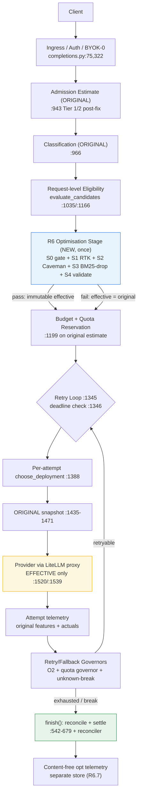

# R6 T10 — Decision Consolidation & Architecture Freeze Preparation

**Status: DECISION CONSOLIDATION COMPLETE — INPUT TO OWNER FREEZE. NO IMPLEMENTATION AUTHORIZED.**

**Programme:** SabiRoute Build Archive
**Workstream:** R6 — Intelligent Input Optimization
**Role of record:** T10 adjudicator (independent consolidation)
**Mode:** Read-only adjudication and freeze preparation. **Implementation NOT AUTHORIZED. No approval granted, no G7 requested.**
**Verified baseline:** `feat/sabiroute-routing-foundation` @ `319a711ef4142e6232a13f6e4bc7ec7fb74cdfaf`
**Baseline verified on:** 2026-11-03 (before investigation and after; §2)
**Source documents (read, preserved intact, not modified):**
- `docs/r6-architecture-decision-pack.md` (R6.0 pack, untracked)
- `docs/r6-decision-resolution-and-approval-campaign.md` (resolution campaign, untracked)
- `docs/r6-t9-capability-recovery-review.md` (T9 report, untracked)
- Installed `litellm-1.103.0` (read-only inspection)
- Live tree `src/`, `config/`, `tests/` at HEAD `319a711` (static inspection; selected regions via `git show`, no execution)

**Files created by this task:** `docs/r6-t10-decision-consolidation-and-freeze-preparation.md` (this file) — **one file, no others.**
**Files modified:** none. No source, config, dependency, migration, dataset, scorecard, or existing-doc modification. No compression executed. No benchmarks run. No provider calls made. No packages installed. No commits, pushes, deploys, resets, cleans, stashes, prunes, or branch changes.

---

## 1. Executive Summary

**Question:** *What architecture should SabiRoute actually implement to maximize useful optimization capability without compromising correctness, reliability, security, accounting integrity, or architectural ownership?*

**Answer.** The owner-accepted T8 direction stands, narrowed but not weakened by T9 evidence and challenged by T10 verification:

1. **Stock `compress()` is excluded from v1 — finally and on three independent grounds**, not one: retrieval-instruction defect (pack/campaign/T9-A agree), `content: null` crash on assistant tool-call turns (T10 verification of `message_stubbing.py:61–65`, STATIC-ANALYSIS FINDING), and SDK-coupling cost (importing any `litellm.compression` symbol executes `litellm/__init__` incl. dotenv load into a process with zero SDK imports today).
2. **BM25 enters the architecture only as a SabiRoute-owned select-and-drop adapter with a vendored or reimplemented scorer** — never as a direct SDK import, never as a `compress()` wrapper. Construction behind a disabled flag is permitted in R6.4; enablement is post-v1 on six proofs.
3. **Tool-bearing optimization is narrowed, not opened.** Class 1 (plain text) is the only eligible class. First-turn tool declarations remain bypass until capability verification changes (all deployments declare `tool_use: unknown` / `structured_output: unknown` today, so top-level tools never reach a provider — 502 — VERIFIED). In-message tool history is invisible to classification — a documented detection gap, not an eligibility grant.
4. **Quota metering has two live integrity defects that must close regardless of R6:** the extras gap (tools/schemas/response_format uncounted on the quota path) and the partial-settlement hole (mixed known/unknown settles a partial sum as complete). Both are budgeted-fix-first, with a bounded quota token governor added.
5. **Retry stays pinned (O2).** Budget path already embodies it. The quota path has no governor at all — the T10 fix is a deterministic quota token governor mirroring `:1599–1608`, plus shadow-mode forecasting only.
6. **All estimator confidence is UNKNOWN.** Ladder adopted as process; no alias promoted without paired evidence; savings language forbidden until BOUNDED+.
7. **R6.0 is CONDITIONALLY READY** — decisions are adjudicated and architecture is consolidated, but owner written approval, Track A sign-off, and Terminal B/C/D/E reconciliation are outstanding. **R6.1 is NOT READY** — it requires the freeze plus separate authorization.

No invariant (§4 of T9 mission; §7 here) is weakened. Every recovery works by narrowing, never by widening trust.

---

## 2. Verified Repository Baseline

VERIFIED by direct inspection this session:

| Item | Value |
|---|---|
| Branch | `feat/sabiroute-routing-foundation` |
| HEAD | `319a711ef4142e6232a13f6e4bc7ec7fb74cdfaf` |
| Expected baseline | same — **matches; repository has not changed** |
| Tracked modifications | none (`git diff --name-only` and `--cached` both empty) |
| Porcelain | only `??` untracked lines; zero non-`??` lines |
| Stash | empty (no stash entries reported) |
| R6 pack | `docs/r6-architecture-decision-pack.md` present, untracked, read |
| Resolution campaign | `docs/r6-decision-resolution-and-approval-campaign.md` present, untracked, read |
| T9 report | `docs/r6-t9-capability-recovery-review.md` present, untracked, read (full §§1–4 + §§5–12 via parallel investigators + direct HEAD reads) |
| T8 decision register in tree | **none found** — no committed T8 register; mission-statement owner acceptance (2026-11-03 conversation) treated as OWNER-ACCEPTED per hierarchy Level 1, scoped strictly to stated decisions |
| Placeholders | 7 zero-byte files confirmed (security/permissions, intelligence classifier/scorer/selector, routing/intelligent, docs/architecture, docs/troubleshooting) |
| Greenfield | no rtk/caveman/bm25/optim module in tree (VERIFIED negative search) |
| This report | absent before this task, no conflict |
| Worktrees | main on-branch; sibling detached/prunable under `/private/tmp` + docs-publishing siblings untouched |

---

## 3. Source-of-Truth and Decision Authority

Hierarchy applied (mission §3):

- **Level 1 — Explicit owner decisions.** T8 recommendations accepted in conversation 2026-11-03 (D6, D8, D14, D10/D20, D18, D19, D21, D22, D23). Treated as OWNER-ACCEPTED, scoped strictly — acceptance is not expanded beyond the stated decision and conditions.
- **Level 2 — Verified repository evidence.** Code/config/tests at `319a711` decide what exists. T10 re-verified: lifecycle anchors, both retry governors, settlement, estimator, schema gate, alias catalog, Track A surfaces.
- **Level 3 — T9 findings.** Challenged, not inherited. T10 ran four parallel read-only investigators (A/B, C/D, E/F-attempted, G/H-attempted; two failed on model errors and were covered by direct HEAD reads) plus direct `git show` verification of lifecycle, settlement, telemetry, and catalog.
- **Level 4 — Pack/campaign recommendations.** Preserved IDs and terminology. Where T9/T10 supersede, relationship is explicit (§6).
- **Level 5 — New T10 proposals.** Labelled RECOMMENDED/PROPOSED/CONDITIONAL; never presented as owner-approved.

Label vocabulary: VERIFIED · PARTIALLY VERIFIED · OWNER-ACCEPTED · RECOMMENDED · PROPOSED · CONDITIONAL · UNRESOLVED · BLOCKED. No blurring.

---

## 4. T8 Owner-Decision Register

All OWNER-ACCEPTED per mission §4 (scope strictly as stated):

| ID | Decision | Scope of acceptance |
|---|---|---|
| D6 | Exclude unsafe stock LiteLLM stubbing from v1 | Stock `compress()` workflow excluded where it injects retrieval instructions, depends on an unavailable round-trip, or exposes originals via cache. Does not prohibit a safe retrieval-free adapter subject to proof + separate enablement gates. OWNER-ACCEPTED |
| D8 | Restrict tool-bearing optimization | No unrestricted optimization of tool-bearing requests. Narrower eligibility for structurally protected requests possible only via T9-gated proposal, not automatic. OWNER-ACCEPTED |
| D14 | Separate optimization telemetry logically | 1.1 integrity preserved; no prompt content; tenant isolation. Sharing allowed only with logical separation + access control + data integrity intact. OWNER-ACCEPTED |
| D10/D20 | Preserve O2 across token and cost retry headroom | Original reservation accounting authoritative; effective-request forecasts separate; no retry loosening without proven accounting argument. Both token and cost paths governed. OWNER-ACCEPTED |
| D18 | Effective-estimate rejection and fallback | Effective estimate only where supported; reject + use original when uncomputable/invalid/exceeds original. Never clamp invalid estimates into eligibility. OWNER-ACCEPTED |
| D19 | Unsupported quota-path request shapes | No silent admission of inadequately estimated shapes. Tiered structured estimation may expand compatibility. Explicit rejection where unvalidatable. OWNER-ACCEPTED |
| D21 | Estimation confidence | Estimates are not universal hard bounds. Per-alias evidence required. Actual usage distinct from estimated savings. OWNER-ACCEPTED |
| D22 | Ordering experiments | Two achievable experiments now; full BM25 comparison deferred until a safe adapter exists. OWNER-ACCEPTED |
| D23 | Unknown usage settlement | Incomplete actuals ≠ complete actuals. Mixed sequences must not settle from a partial sum. Recovery bounded, idempotent, evidence-driven. OWNER-ACCEPTED |

---

## 5. T9 Findings Adjudication

### T9-A — BM25 recovery (D6) — VERIFIED core, NARROWED recommendation

- **Finding:** retrieval-free BM25 feasible via standalone `bm25_score_messages` (`bm25.py:33–38`, pure stdlib) or vendored scorer. VERIFIED (signature, stdlib-only imports, empty-query all-0.0, list-content partial handling).
- **T10 challenge — three new constraints:**
  1. **ASCII-only tokenizer** (`re.findall(r"[a-z0-9_]+", text.lower())`, `bm25.py:12–14`): Yoruba diacritics, Arabic, CJK, emoji score 0. Material limitation for SabiRoute's market; corpus must cover it. PARTIALLY VERIFIED (read, not executed).
  2. **SDK import side effect:** any `litellm.compression` import executes `litellm/__init__` (dotenv load + `.main`), while `src/` imports the SDK zero times today. Direct-primitive option (A) introduces process-level coupling under a loose `litellm>=1.80.0` pin. VERIFIED (export surface: `compress` top-level, bm25 deep-path only).
  3. **`content: null` crash:** `stub_message` (`message_stubbing.py:61–65`) calls `.count("\n")` on `message.get("content", "")` — `None.count` raises. Standard OpenAI assistant tool-call turns carry `content: null`. Any non-protected null-content message selected for stubbing/truncation raises. STATIC-ANALYSIS FINDING (code fact read; runtime consequence not executed per mission rules).
  4. **Transport decisive:** SabiRoute speaks HTTP to the LiteLLM proxy (`litellm_client.py:71–90, 133–160`), not via SDK. Proxy-side compression hook only fires for `anthropic_messages` (`handler.py:138–143`), never for `/v1/chat/completions`. VERIFIED.
  5. **Tool spans on completion path:** `tool_exchange_spans` stays `[]` unless anthropic call type (`compress.py:447–464`). VERIFIED.
- **Adjudication:** options (A) direct import and (C) internals-adapter **REJECTED**; (B) SabiRoute-owned select-and-drop with **vendored/reimplemented scorer** (D-semantics inside B-ownership) **RECOMMENDED** — construction behind disabled flag in R6.4, enablement post-v1 on six proofs. See §6 D6.

### T9-B — Tool-bearing recovery (D8) — VERIFIED facts, DEFERS Class-2 enablement

- **Facts VERIFIED:** `model_extra` shape (`completions.py:140–147`); top-level detection in `capabilities.py:104–121` + `dataset.py:189–202`; zero `tool_calls|tool_call_id|function_call|parallel_tool` hits in `src/`+`tests/`; `response_format` classified only; estimator fail-closed on non-str/non-scalar; length cap string-only (`:347–357`); role never read on routing path (SabiChat only); extras forwarding/popping (`:900–918`, client verbatim).
- **T10 decisive finding — capability gate (VERIFIED):** `Router.evaluate_candidates` excludes on unknown (`router.py:195–210`); `config/config.yaml` declares `tool_use: unknown` + `structured_output: unknown` for every deployment, with zero `true` values repo-wide. Top-level `tools`/`response_format` requests → `NoCapableDeploymentError` → 502. **They never reach a provider today.** First-turn declarations are therefore not "admittable but bypassed" — they are capability-blocked upstream.
- **In-message tool history gap (VERIFIED):** invisible to classification/telemetry/estimator-shape (except generic scalar reject on budgeted path → 400). Unbudgeted path forwards verbatim to an unverified deployment. Documented as a detection gap, not an eligibility grant.
- **Adjudication:** Class 1 ELIGIBLE (only class any rewriting feature may touch); Class 2 (first-turn declarations) CONDITIONAL on capability verification + five proofs — **not enabled by this report**; Class 3 (live exchanges, forced `tool_choice`, structured output, multimodal, ambiguous) mandatory BYPASS. Role-aware system/developer freeze is prerequisite to any Class-1 FULL claim.

### T9-C — Structured quota estimation (D19) — VERIFIED defect, ACCEPT Tier 1, CONDITIONAL Tier 2

- **VERIFIED:** estimator formula + 16/4 framing + fail-closed shapes (`budgets.py:16–40`); three call sites (budget admission `:943`, quota admission `:1088`, snapshot `dataset.py:161`); reservation sizing `:1199–1201`; budget closed allowlist (`:949–964`) vs **no extras check on quota path** (`:1073–1104`; `unsupported_parameters` occurs only at `:949/:956`); verbatim forwarding; mislabeled quota shape error (`quota_max_tokens_required` for shape rejections); `n>1` output-multiplier unreserved; settlement self-corrects only when actuals known.
- **Reachability:** gap live when `budget is None`. Whether the SabiChat service key carries a budget row is UNRESOLVED (config/runtime, read-only limit).
- **Adjudication:** Tier 1 (text baseline + quota extras parity + dedicated `quota_request_unsupported` type + quota-estimate recording) ACCEPT as metering-integrity fix, budget path untouched. Tier 2 (capped structural counting) CONDITIONAL on telemetry-join audit setting depth/width/byte caps + cap-trip tests + version persistence. Tier 3 (explicit refusal) ACCEPT as stated. Never clamp, never zero-fill.

### T9-D — Retry headroom (D10/D20) — VERIFIED, EXTENDED with quota-governor fix

- **VERIFIED:** write-once E (`:943`), R (`:1199`), C_est (`:1201`); monotone non-increasing `max_tokens` (`:1608` min-only); cost governor (`:1408–1431`) + token governor (`:1599–1608`); settlement on actuals; unknown→fail-closed matrix on budget path; **absence of any `optimiz|effective|validated|savings` symbol in `src/`** (no savings input surface exists).
- **T10 extension — quota has no governor (VERIFIED):** `quota_reserved` appears only in admission/settlement, never in either governor. Per-request consumption ≤ `N·(actual_in + n·M)` against reservation `est_in + M` — with N=3, M≈49k, n=1, ≈147k tokens consumable against a 50k daily allowance (≈2.94×). Admission is one-shot; settlement grows `consumed_tokens` beyond reservation (`store.py:1360–1375`). Real overrun, not display artifact. INFERRED bound from VERIFIED arithmetic; `max_attempts` per policy 1–3 (cheap=1, default 2, several routes 3 — VERIFIED).
- **Adjudication:** (A) status quo for budget control; ADD deterministic quota token governor (mirror `:1599–1608` behind `quota_reserved`) as Tier-1 fix; (D) shadow-mode validated-estimate logging only (clamped, zero control); (B) unclamped forecasting REJECTED (provider-reported prompt is provider-controlled — loosening on under-report is fail-open); (C) separate heads DEFERRED to schema work pending shadow data.

### T9-E — Estimator confidence (D21) — VERIFIED zero-state, ACCEPT process

- **VERIFIED:** six consumers traced; usage trail end-to-end (parse → per-attempt records → builder → cumulative idiom → settlement → finalize); cost is registry-computed, not billed (`_actual_cost` returns None on unknown, `:1992–2012`); **zero `savings|billed` hits in src/tests/config**; 14 aliases cataloged (`config.yaml:17–254`), zero per-alias calibration/tokenizer/tiktoken; `USAGE_SOURCES={unknown,free_pool,byok,paid}` (`keys.py:89`), single live assignment (`free_pool`); zero error-measurement (phase10 tests are tautology/hold-behavior).
- **Adjudication:** UNKNOWN→UNCALIBRATED→BOUNDED→CALIBRATED ladder ACCEPTED as process with auto-demotion; labelling discipline (`estimated_*` vs `provider_reported_*` vs `billed_*` — never emit); savings language forbidden until BOUNDED+; promotion requires N_min audited pairs + two-window sustain + human review + approval record. All aliases stay UNKNOWN.

### T9-F — Ordering experiments (D22) — ACCEPT staged plan

- **VERIFIED layout:** greenfield (no stage modules; 7 zero-byte placeholders beside 71KB `dataset.py` + implemented routing files); stage contract + S0-first/S4-last/S5-observer from pack/campaign; D6 gates + D9 ruling (freeze interfaces, ordering configurable, measure in R6.6).
- **Adjudication:** E3 integrity harness (prerequisite) → E1 swap → E2 ablation (Stage A, R6.5/R6.6); full triple deferred to Stage B post-adapter. Comparability via frozen corpus versions + pre-registered criteria. No third pre-BM25 experiment (indistinguishable by definition).

### T9-G — Unknown usage settlement (D23) — BUG REPRODUCED, fix ACCEPTED

- **REPRODUCED line sequence (VERIFIED):** `finish()` quota branch (`:596–620`) settles `_sum_actual_tokens(...)[2]` with no unknown consult; `provider_usage_unknown` appears 0× in that branch (5× set-sites elsewhere: `:1572/:1574/:1628/:1693/:1812`); `_sum_actual_tokens` skips Nones (`:253–264`) returning partial sums; `settle_quota` treats any non-None as complete (`store.py:1369`). Comment at `:597–599` describes unimplemented intent. Unknown fail-closed for budget, **fail-open for quota**. Correct sub-cases (all-unknown→estimate, zero-attempt→release, pre-attempt-cancel→release, idempotency guards, no-expiry schema) VERIFIED as not-vulnerable.
- **Adjudication:** pass unknown flag into `finish()`; settle-at-estimate on any unknown; `:1601` break regardless of budget; bounded settle-only reconciler; `settled_estimate` status; REJECT blind TTL release (over-retention bounded/visible vs under-settlement invisible leak).

### T9-H — Telemetry infrastructure (D14) — VERIFIED gate chain, Option A CONDITIONAL

- **VERIFIED:** 1.1 gate load-bearing (Literal + forbid/frozen models; tripwires at `dataset.py:341,902,1247,1435,1460–61` + `keys.py:237–243`); store inventory (`_API_KEYS/_REQUEST_USAGE/_QUOTA_*/_ACCOUNTING_LINEAGES`, SabiChat tables; additive-only migration rule); no event-type mechanism; attempt emission (snapshot/builder/sinks/admin full-row read `:281–331`, no projection, no per-operator ACL); tenant isolation = WHERE-clause + shared secret (snapshot-append by request_id-only lookup is a noted gap); telemetry fail-closed default, no drop-record helper.
- **Adjudication:** (A) separate table ACCEPTED CONDITIONAL on (1) new non-blocking write convention shipping first + (2) key_id-write predicate mirroring finalize; (B) separate column CONDITIONAL with all strict conditions; (C) in-record merge REJECTED (disguised 1.2 migration + label-leakage surface).

---

## 6. Consolidated D6/D8/D10/D14/D18/D19/D20/D21/D22/D23 Decisions

Previous position → new ruling → reason → evidence → trade-off → approval required.

| ID | Previous | T10 ruling | Reason | Evidence | Trade-off | Approval |
|---|---|---|---|---|---|---|
| D6 | (d)-for-v1 + (b)-via-adapter path | **NARROWED: (d) for v1; (b′) SabiRoute-owned select-and-drop with vendored/reimplemented scorer, disabled-built in R6.4, enabled post-v1 on six proofs. Direct SDK import (A) and compress()-internals adapter (C) REJECTED.** | Three independent exclusions (instruction defect + null-crash + SDK coupling); ASCII-tokenizer limitation; HTTP transport makes proxy-side compression inapplicable | bm25.py; compress.py:447–464, stub 61–65; exports; litellm_client; handler 138–143 | Gain: lexical selection without stub/round-trip. Sacrifice: recoverability markers, embedding signal. Complexity: ~100-line selector + tool-atomicity + caps. Reversible (flag). | T8+Owner; Track A (insertion) |
| D8 | blanket v1 bypass unless D6(b)+pairing proof | **NARROWED: Class 1 eligible; Class 2 CONDITIONAL (capability verification + role-aware freeze + five proofs — not enabled here); Class 3 mandatory bypass.** | Capability gate blocks top-level tools upstream (502); in-message history invisible (gap ≠ grant); role-blindness today | capabilities/dataset/completions/router/config.yaml | Gain: plain-text traffic optimizable. Sacrifice: agentic long-context stays bypass. Complexity: eligibility gate + payload-capture tests. | T8+Owner; Track A if in Track A files |
| D10/D20 | O2 pinned estimate (RECOMMENDED, pending B/C adjudication) | **CONFIRMED O2 + ADD quota token governor (mirror :1599–1608 behind quota_reserved) as Tier-1 fix. Shadow-E′ logging only (clamped ≤E). Unclamped (B) REJECTED; fungible pools REJECTED.** | Budget path already O2; quota path ungoverned with real overrun bound; provider-reported prompts are provider-controlled | governors; write-once symbols; absence grep; N·(in+n·M) bound | Gain: retry invariance + quota integrity. Sacrifice: none (shadow costs only logging). Complexity: low. | T8+Owner; Track A; B/C adjudication now satisfied by this evidence (Terminal B/C reconciliation still welcomed pre-R6.1) |
| D14 | separate content-free record, 1.1 unchanged | **CONFIRMED Option A, CONDITIONAL on non-blocking write convention first + key_id-write predicate. (B) conditional; (C) REJECTED.** | 1.1 gate load-bearing (6+ tripwires); admin full-row read; fail-closed default with no drop helper | dataset.py gate chain; store.py; admin.py | Gain: optimization observability without training-surface contamination. Sacrifice: second table + convention build. Reversible. | Track A+T8; Owner (strategy) |
| D18 | (owner-accepted; no prior register text) | **CONFIRMED unchanged: effective estimate only where supported; reject→original; never clamp into eligibility.** | Clamping manufactures eligibility from invalid numbers | Owner acceptance + T9-D absence of estimate symbols | Gain: fail-closed discipline. Sacrifice: none. | Owner (already accepted) |
| D19 | (owner-accepted direction; tiers proposed by T9) | **ACCEPT Tier 1 + Tier 3 now; Tier 2 CONDITIONAL on telemetry-join audit caps. Budget path frozen. New `quota_request_unsupported` type. Fix n>1 accounting note as part of Tier 1.** | Silent under-reservation is metering-integrity bug; must close regardless of R6 | budgets.py; :949–964 vs :1073–1104; litellm_client; settle paths | Gain: bounded-structured admission with conservative hold. Sacrifice: over-cap shapes denied with named reasons. | T8+Owner; Track A |
| D21 | (owner-accepted direction; ladder proposed by T9) | **ACCEPT ladder + labelling + auto-demotion as process. All 14 aliases UNKNOWN. No code grants calibration.** | Zero paired rows; byte bound unproven; savings fields absent | absence greps; join keys; catalog; phase10 tests | Gain: future calibration path. Sacrifice: no savings claims until BOUNDED+. | T8; Owner (byok/paid semantics + billing-source scope) |
| D22 | freeze interfaces, ordering configurable; measure in R6.6 | **CONFIRMED staged: E3→E1→E2 (Stage A); full triple Stage B post-adapter.** | Only 2 pre-BM25 orders distinguishable; harness prerequisite | greenfield; D6 gates; D9 ruling | Gain: unblocks R6.5/R6.6 without BM25. Sacrifice: none. | T8+Terminal D; Owner only for early order-fixing |
| D23 | (owner-accepted direction; fix proposed by T9) | **ACCEPT fix + bounded settle-only reconciler; REJECT blind TTL release. Settle-at-estimate on any unknown; `:1601` break regardless of budget; `settled_estimate` status.** | Partial-settlement hole reproduced; over-retention bounded/visible vs under-settlement invisible leak | finish :596–620; _sum :253–264; settle_quota :1369; no-expiry schema | Gain: closes live settlement hole, strengthens invariant 13. Sacrifice: reconciler surface (bounded, settle-only). | T8+Owner; Track A (required) |

---

## 7. New T10 Decision Proposals

| ID | Subject | Proposal | Evidence | Approval | Stage |
|---|---|---|---|---|---|
| T10-1 | SDK-coupling prohibition | No `litellm` SDK import in the gateway request path; BM25 scoring vendored or reimplemented with attribution. Exception requires version-pin + env-diff + startup-cost evidence. | Zero SDK imports today; `__init__` side effects; loose pin | T8+Owner | R6.4 |
| T10-2 | Multilingual scoring limitation | BM25 relevance claims exclude non-Latin scripts until tokenizer coverage proven; corpus must include Yoruba-diacritic/Arabic/CJK/emoji adversarial items. | bm25.py:12–14 ASCII regex | T8+Terminal D | R6.6 |
| T10-3 | Null-content hardening | Any pre-provider transform must handle `content: null` + in-message tool keys without exception; crash-fixture mandatory in B1. | message_stubbing crash shape; zero tool-key hits | T8 | R6.1 |
| T10-4 | Capability-verification prerequisite | No Class-2 enablement until ≥1 deployment verifies `tool_use`/`structured_output` at runtime; config `unknown` means excluded. | router.py:195–210; config.yaml all-unknown | T8+Owner | R6.5+ |
| T10-5 | Quota token governor | Mirror budget token governor behind `quota_reserved`; retries shrink `max_tokens` identically; unknown breaks. | Quota overrun bound §5 T9-D | T8+Owner; Track A | R6.1 |
| T10-6 | In-message tool detection | Add syntactic detection of in-message tool keys for classification/telemetry/bypass (no semantic execution). Closes verbatim-forward-to-unverified-deployment gap. | Zero-hit grep + verbatim forward | T8; Track A if in completions.py | R6.1 |
| T10-7 | Telemetry non-blocking convention | Build + test the non-blocking write convention before any optimization writes; failure-proof test (telemetry failure ⇒ request unaffected). | Fail-closed default; no drop helper | Track A+T8 | R6.1 |

---

## 8. Consolidated Architecture

**Ownership:** SabiRoute decides (classification, eligibility, policy, admission, reservation, routing, fallback, settlement, telemetry). LiteLLM executes (provider transport, provider adapters). No SabiRoute request-path dependency on the litellm SDK (T10-1).

**Request representations:** Original (`payload.messages`, immutable) → Effective (`effective_messages`, immutable once built, sole provider reader) → Record (content-free telemetry). One validated effective per logical request; retries/fallbacks reuse it; failure yields byte-identical original.

**Stage pipeline (R6.1→R6.5):** S0 eligibility (incl. Class gate + T10-6 detection + role-aware freeze) → S1 RTK → S2 Caveman → S3 BM25-adapter (select-and-drop, disabled until post-v1) → S4 validation (shape, frozen-subtree, order, budget, payload-capture) + BYOK-0 recheck → provider. S5 observes only.

**What happens before reservation?** Ingress → auth → BYOK-0 deny-list → alias→policy resolution → admission estimate on ORIGINAL (`:943`, Tier 1/2 estimator post-Tier-1-fix) → classification on ORIGINAL (`:966`) → request-level capability/health eligibility (`evaluate_candidates`) → **NEW R6 optimisation stage (single, before loop entry)** producing immutable effective binding → budget reservation on original estimate (`:1199`) + quota reservation.

**After reservation but before the retry loop?** Snapshot hooks read `payload.messages` (original); effective binding frozen; deadline budget propagated; O2 pinning recorded for governor reference.

**Inside the retry loop?** Loop entry + deadline check (`:1345–1346`); per-attempt deployment selection (`choose_deployment :1388`, excluding attempted); ORIGINAL feature snapshot; provider invocation reading EFFECTIVE only; attempt telemetry (original features + provider actuals); retry/fallback decision under O2 + quota governor (T10-5) + unknown-break.

**After each provider attempt?** Parse `_actual_tokens`; append to cumulative parts; compute cost; on retryable failure with known usage continue under governors; on unknown break fail-closed; streaming paths identical with completed/interrupted distinction.

**During settlement?** `finish()`: budget reconcile (unknown holds estimate) · quota settle (unknown holds estimate post-D23-fix; never partial-as-complete) · exactly one settle-or-release per logical request · finalize usage event with estimate+reservation+actuals side by side.

**When optimization fails?** Fail to byte-identical original; `optimization_timeout` category distinct from provider `deadline_exceeded`; no partial candidates escape S4.

**When provider usage is unknown?** Hold estimate (both heads), break retry, mark `settled_estimate` where applicable, bounded reconciler owns stuck rows (settle-only, N/pass + jitter + alert after 3, admin-visible). Never release-to-zero, never partial-as-complete, never blind TTL.

---

## 9. Mermaid Architecture Diagram



---

## 10. Mermaid Request Lifecycle Diagram

```mermaid
sequenceDiagram
    participant C as Client
    participant G as Gateway
    participant O as R6 Optimiser (once)
    participant R as Router
    participant P as LiteLLM Proxy/Provider
    participant S as Settlement
    C->>G: request (original immutable)
    G->>G: BYOK-0 + admission est (ORIG) + classify (ORIG)
    G->>O: eligible? S0 gate (Class 1 only; T10-6 detection)
    O-->>G: effective = candidate | original (fail-closed)
    G->>G: reserve budget + quota (original basis)
    loop each attempt (same effective object)
        G->>R: choose_deployment (exclude attempted)
        G->>G: ORIGINAL snapshot + telemetry
        G->>P: POST /v1/chat/completions (EFFECTIVE only)
        P-->>G: body + usage (or unknown)
        G->>G: governors (O2 + quota; unknown breaks)
    end
    G->>S: finish(): reconcile/settle (unknown holds estimate)
    S-->>G: settled | settled_estimate | released
    G->>C: response (X-SabiRoute-Request-ID)
```

---

## 11. Request Eligibility Matrix

| Class | Shape | Policy | Rationale |
|---|---|---|---|
| 1 — plain text | dicts, `content: str`, scalar metadata, no top-level tools/choice/format, no list content, no in-message tool keys, role-aware freeze holds | ELIGIBLE (only class any rewriting may touch) | Estimator sizes it; capabilities routable; test-proven |
| 2a — first-turn declarations | top-level tools/choice/format present, zero tool activity, structures frozen | CONDITIONAL BYPASS (enablement requires T10-4 capability verification + five proofs; not enabled here) | Capability-blocked upstream (502) today; narrowing candidate only |
| 2b — in-message tool history | any `tool_calls`/`tool_call_id`/`function_call`/`tool` role / `content: null` | MANDATORY BYPASS + T10-6 detection | Invisible today; verbatim-forward gap; crash shape |
| 3a — live exchanges / forced choice | multi-step tool traffic, forced `tool_choice` beyond absent/none/auto | MANDATORY BYPASS | Pairing/atomicity unproven; forced-choice semantics UNRESOLVED |
| 3b — structured output | any `response_format` beyond none | MANDATORY BYPASS | No schema-aware validator |
| 3c — multimodal | list content, image/audio/video parts | MANDATORY BYPASS | Estimator fail-closed + cap-blind + capability-blocked |
| 3d — ambiguous/opaque | unknown fields, `extra_body`/`litellm_params`, over-cap Tier 2, estimator rejection | MANDATORY BYPASS (Tier 3 explicit refusal) | Never silent; never zero-filled |

---

## 12. Estimation and Accounting Policy

- **Basis:** original request governs admission, reservation, retry arithmetic. Effective-request figures are forecasts only (shadow until tightening-only, clamped ≤E, never control).
- **Tier 1:** text baseline (identical computation budget/quota); quota extras parity; `quota_request_unsupported` type; quota-estimate recorded on event. Budget path frozen.
- **Tier 2:** capped structural (per-unit framing + depth/width/byte caps; trip→Tier 3 named denial); version `quota-est-v1` persisted; determinism via canonical compact JSON.
- **Tier 3:** explicit refusal with reason pointer; no reservation row, no provider call; counted distinctly from `quota_exceeded`.
- **Labelling:** `estimated_*` (byte formula, unproven bound) vs `provider_reported_*`/`actual_*` (parsed bodies) vs `billed_*` (no source — never emit). `*savings*` forbidden until BOUNDED+ with stated counterfactual.
- **D18:** uncomputable/invalid/over-original effective estimates → reject to original; never clamp into eligibility.

---

## 13. Retry and Fallback Policy

- **O2 confirmed:** eligibility and caps pinned to original-estimate basis; savings never buy attempts or output headroom. Settlement still on actuals (savings real, billed).
- **Token governor (budget):** `remaining = R − Σtotals; break if remaining ≤ E; max_tokens = min(max_tokens, remaining − E)` — monotone shrink. VERIFIED.
- **Cost governor (budget + monetary limit):** cumulative spend ≤ ~C_est (one worst-case attempt), current input forecast at E; fail-closed on unpriceable/missing. VERIFIED.
- **Quota governor (NEW T10-5):** mirror token governor behind `quota_reserved`. Closes the N·(in+n·M) overrun.
- **Unknown:** break regardless of budget (extend `:1601`); settle-at-estimate; no control use of validated estimates beyond clamped shadow logging; fungible pools rejected; `max_tokens` mutation ratchets all future attempts (never increases).
- **Fallback:** same effective object across deployments; no per-attempt re-optimization (D12 structural); tokenizer-agnosticism validated per stage or bypassed (D11-C + compat matrix).

---

## 14. Unknown Usage and Reservation Recovery Policy

1. Pass unknown flag into `finish()`; settle-at-estimate on any unknown signal (flag, banked total-None, success/stream-completed without usage).
2. Partial sums never reach `settle_quota` as `actual_tokens`.
3. Request path breaks on unknown regardless of head type (quota fail-closed like budget).
4. Bounded reconciler owns stuck `reserved` rows (older than threshold, usage event finalized): settle-at-estimate ONLY, N rows/pass + jitter + metrics, 3-strikes-then-alert (row stays reserved — visible over-retention beats invisible under-settlement).
5. `settled_estimate` status + reason persisted (row or telemetry); stuck counts on admin.
6. Idempotency via existing store entry points (reserved→settled once, SELECT..FOR UPDATE, no-op on repeat).
7. Crash-mid-request = stuck-row case; process crash between reserve and finish covered by reconciler.
8. **Blind TTL release REJECTED** with accounting analysis (§5 T9-G).

---

## 15. Telemetry Architecture

- **Schema 1.1 frozen.** No attempt-record/feature fields. Six tripwires stay enforcing.
- **Option A (CONDITIONAL):** separate table (e.g. `sabiroute_optimization_records`, PK (request_id, attempt_number), key_id + project_id NOT NULL), scalar-only `extra="forbid"` frozen builder (stage outcomes, bypass reasons, validation verdicts, estimated vs provider-reported ints, latency ms, config version — never messages/options/responses/cache/secrets), narrow admin projection, key_id-write predicate mirroring finalize, non-blocking write convention (T10-7) first.
- **Option B:** separate nullable JSON column + dedicated endpoint, only with event-type registry + read-projection allowlist + exclusion from diagnostic/training scope + same non-blocking write.
- **Option C:** REJECTED.
- **Tenant isolation:** partition-by-table (A) or convention-guarded narrow endpoint (B); full-row admin endpoint never gains optimization columns.

---

## 16. Consolidated R6 Roadmap

No stage merged, renamed, reordered, or removed. Dependency clarifications only:

- **R6.0:** ingest T9 + this T10; resolve D6/D8/D10/D14/D18/D19/D20/D21/D22/D23 + T10-1…T10-7; define S0–S5 interfaces + ownership; fix lifecycle placement (optimisation once before `:1345`); tokenizer policy C + compat-matrix gate; Track A matrix recorded; owner written approval. Exit: approval + decision baseline.
- **R6.1:** immutable original + canonical representation + metadata + policy/capability checks + explicit bypass + fail-to-original **plus** T10 carries: role-aware freeze, T10-6 detection, Tier 1 bookkeeping, D23 fix + `:1601` hardening, quota governor (T10-5), shadow-E′ logging, non-blocking convention (T10-7), null-content hardening (T10-3). Exit: safe no-op + bypass + E3 harness green.
- **R6.2 (RTK):** per-tenant namespace + TTL + no stale/cross-tenant reuse tests; state key includes policy/model/context.
- **R6.3 (Caveman):** natural-language spans only + protected-class bypass + fail-closed validation; shared role-aware freeze.
- **R6.4 (BM25):** disabled-built (b′)-adapter: direct integration path, hard-pinned local scoring (no embeddings), supported-format checks, bounded execution, tokenizer-compat checks; exit = disabled-boundary proof (vacuous-but-verifiable). Enablement post-v1 on six proofs + D11 matrix + D8-pairing independence.
- **R6.5:** freeze stable interfaces (ordering configurable); one validated effective per logical request; E1/E2 on frozen corpus v1 with pre-registered criteria; T10-4 gates any Class-2 consideration.
- **R6.6:** B1 gates (all §17 additions incl. null-crash, ASCII-coverage, tool-atomicity, stub/cache-absence) + E1/E2 evidence; D9 order not selected for BM25; Terminal D reconciliation before G4.
- **R6.7:** Option-A store (convention + table + projection + canary); savings-vs-actual reporting for BOUNDED+ only; disabled-by-default rollout; reconciler operationalized.

---

## 17. Benchmark and Validation Gates

B1 (offline/mechanical, blocking) + B2 (provider-measured, advisory until thresholds pre-declared — D15; no B2 results fabricated here):

- **B1 additions from T10:** null-content crash fixtures; ASCII-tokenizer multilingual items (Yoruba/Arabic/CJK/emoji score-zero expectations); tool-pair atomicity (parallel calls, reordered/duplicated/dropped results, single-char ID mutation); stub-instruction absence (`litellm_content_retrieve` substring scan of every emitted payload); cache-absence (no full-original object traverses provider path); frozen-subtree deep-equal; budget-order conformance; retry-identity per order; shadow-E′ agreement metric; tenant namespace/TTL; builder signature test (no message/options parameter); table-has-no-text-column assertion; non-blocking proof.
- **B2:** actual prompt-token reduction, provider usage, per-stage vs provider latency separation, cost per successful task, per-alias error (bias/MAE/RMSE/p50/p95/p99/P(estimate<actual)/unknown-rate per size+unicode bucket). Minimum adversarial: §11 matrix + Tier 2 cap-boundary ±1 + unknown-settlement reconciliation where separately authorized.
- **Corpus:** pack §16.3 + tool-lifecycle shapes + structured shapes at depth limits + extras-carried modalities + forced-choice objects + unknown-trajectory shapes. Versioned, secret-free, stable IDs/hashes/provenance/redaction scan.

---

## 18. Track A Approval Dependencies

Protected (campaign §15 + conflict controls): `completions.py`, `gateway.py`, `main.py`, `config/validation.py`, `security/store.py`, migrations, dataset-related files. Verified present at HEAD.

| Item | Required approval | Owner | Dependency | Blocks |
|---|---|---|---|---|
| T1 optimisation insertion + effective binding | Track A | external reviewer | review evidence | R6.1/R6.4 |
| T2 O2 pinning + quota governor (T10-5) + `:1601` hardening | Track A | external reviewer | §5 arithmetic + bound | R6.1 |
| T3 `optimization_timeout` category | Track A | external reviewer | taxonomy test | R6.1 |
| T4 R6 flag + limits + kill switch | Track A | external reviewer | validation tests | R6.1 |
| T5 bounded executor lifecycle | Track A | external reviewer | executor tests | R6.1 |
| T6 content-free opt store + non-blocking convention | Track A | external reviewer | canary + conformance | R6.1 convention / R6.7 writes |
| T7 D23 settlement fix + reconciler | Track A | external reviewer | mixed-settle + idempotency tests | R6.1 fix / R6.7 ops |
| Tier 1 estimator + `quota_request_unsupported` + version field | Track A | external reviewer | gap-closure + budget-regression tests | R6.1 / R6.4 use |
| Architecture decisions (this report) | Owner | project owner | T10 adjudication | R6.0 freeze |
| New implementation (R6.1+) | Owner | project owner | separate authorization (G7) | R6.1 |
| Release | Owner | project owner | test + rollout evidence | production |

Track A ≠ owner approval. Silence is not approval. No T10 authorization claimed over any Track A surface.

---

## 19. R6.0 Freeze Readiness Audit

| # | Criterion | Status | Evidence |
|---|---|---|---|
| 1 | Decision register completeness | CONDITIONAL | D1–D23 + T10-1…T10-7 adjudicated here; T8 register still uncommitted in tree |
| 2 | Owner-decision documentation | CONDITIONAL | Level-1 acceptance scoped in §4; written freeze approval outstanding |
| 3 | T8/T9 reconciliation | PASS | §§5–6; conflicts resolved (A/C rejected, Class-2 deferred, quota governor added) |
| 4 | Architectural invariants | PASS | 18 invariants (§7); every accepted proposal satisfies all; breaches rejected |
| 5 | Stage ownership | PASS | S0–S5 owners + interfaces (§8); T10-1 ownership rule |
| 6 | Request lifecycle placement | PASS | Before `:1345`, effective frozen, snapshot reads original (VERIFIED anchors) |
| 7 | Budget and quota policy | CONDITIONAL | Tier 1 + quota governor specified; implementation + Track A pending |
| 8 | Retry and fallback policy | CONDITIONAL | O2 confirmed + quota governor specified; code change pending |
| 9 | Unknown usage settlement | CONDITIONAL | Fix + reconciler specified; code change pending (hole reproduced, not yet closed) |
| 10 | BM25 integration policy | CONDITIONAL | (b′) specified with six proofs; construction + enablement gates pending |
| 11 | Tool-bearing eligibility | CONDITIONAL | Class matrix + T10-4 prerequisite; detection + freeze pending |
| 12 | Estimator confidence policy | PASS | Ladder + labelling + demotion as process; all UNKNOWN |
| 13 | Benchmark design | CONDITIONAL | B1 additions + corpus deltas specified; Terminal D reconciliation pending |
| 14 | Telemetry architecture | CONDITIONAL | Option A specified; convention + table pending |
| 15 | Track A dependencies | BLOCKED | Matrix recorded (§18); sign-off not obtained |
| 16 | Deployment-tokenizer policy | CONDITIONAL | Policy C + compat-matrix gate; matrices pending |
| 17 | Rollout and release gates | PASS | Default-off + kill switch + G4/G5/G7 positions preserved |

**Overall: CONDITIONALLY READY — SPECIFIC ITEMS REMAIN.** Decisions are adjudicated; architecture is consolidated; what remains is approvals + specified evidence, not open design. NOT READY for owner signature until Track A engagement + Terminal B/C/D/E reconciliation are at least scheduled with recorded prompts (§13 of campaign reused).

---

## 20. R6.1 Implementation Readiness

Prerequisites: R6.0 written owner approval → Track A sign-off on T1–T7 + Tier-1 estimator → S0–S5 interface definitions frozen → config/migration decisions (flag schema, version field, Option-A table DDL deferred to R6.7 except convention) → required tests (§17 B1 subset for R6.1: placement, byte-identity, bypass, null-crash, retry-identity, quota-governor, mixed-settle, unknown-break, idempotency, non-blocking proof) → G7 separate authorization.

Sensitive-file dependencies: `completions.py` (insertion, governors, detection), `gateway.py`/`main.py` (flag, pool lifecycle), `config/validation.py` (flag/limits), `security/store.py` (convention, version field, reconciler later).

Risks: quota-governor behavior change on Free Chat traffic (mitigate: shadow-compare first); T10-6 detection false positives (mitigate: syntactic-only, bypass-direction); estimator Tier-1 error-type flip breaking clients (mitigate: distinct type + changelog + dual-run).

**Conclusion: R6.1 NOT READY.** R6.0 approval does not authorize it; prerequisites above are unmet by design at freeze-preparation stage. No implementation started.

---

## 21. Remaining Unknowns and Required Investigations

Consolidated (each with smallest next step; all read-only unless noted):

1. SDK import cost/env-diff (T10-1 exception evidence) — throwaway `import litellm` timing + `os.environ` diff. (~10 min, sandbox)
2. Proxy `tools`/`response_format` forwarding fidelity — proxy version/config read, then single local invalid-key validation call. (~20 min)
3. `compress()` null-crash runtime proof — isolated `stub_message({content:None})` call in scratch interpreter. (~5 min)
4. First-turn vs live-tool traffic shape census (T10-4 scoping) — read-only telemetry/log inspection. (~30 min)
5. Service-key budget row (quota-gap reachability) — seed config/admin read. (~10 min)
6. Completed-stream-without-usage provider behavior — stub SSE + provider docs in `config/`. (~20 min)
7. Generator-close settlement guarantee — targeted test or runtime evidence. (~30 min)
8. Live paired-row census (E-U1) — run existing dataset audit over deployed store copy. (~30 min + query)
9. Tokenizer-family map (E-U2) — `litellm_params.model` → families from config+docs. (~20 min)
10. byok/paid semantics + billing-source scope (E-U3/U4) — owner conversation.
11. R6 docs canonical status — owner ruling whether untracked copies commit. (conversation)
12. Order-selection criteria (Prompt D) — issue + record Terminal D demands pre-R6.6.
13. Configurable-ordering boundary (U4) — T8 ruling S0-first/S4-last/S5-observer frozen.
14. Admin repair-path census — full `admin.py` quota read. (~15 min)
15. Quota-without-budget liveness — config read. (~15 min)
16. Mixed-usage test expectations — read `test_user_quotas.py` mixed cases the D23 fix must update. (~20 min)
17. Telemetry writer census — repo-wide caller check for the two writers. (~15 min)
18. A-vs-vendored scorer + last-assistant policy — owner decision, then contract test first.

---

## 22. Rejected Alternatives and Trade-offs

| Rejected | Why | Trade-off consciously accepted |
|---|---|---|
| Stock `compress()` adoption (any wrapper) | Instruction defect + null-crash + no fulfillment loop; correctness, not hardening | Forfeit stub-recoverability; keep correctness |
| Direct SDK primitive import | SDK process coupling (dotenv, pin) for a pure function; HTTP transport anyway | Maintain vendored scorer (~60–118 lines, attributed) |
| Internals adapter (post-hoc strip) | Private names × 3 modules + inverted fail-closed + crash + tool injection | SabiRoute-owned selector, never-create-unsafe-artifacts |
| Embedding-backed mechanical scoring | Provider call in mechanical path (S10 breach) + offline-testability loss | Lexical signal only; embeddings out of R6 |
| Broad tool-bearing optimization | Capability-blocked + invisible history + pairing unproven | Agentic long-context stays bypass in v1 |
| Pre-validation savings claims | Zero paired rows; fields absent; bound unproven | No savings language until BOUNDED+ |
| Unclamped validated-estimate retry / fungible pools | Provider-controlled loosening; stale/underestimate overrun over unverified attempt bound | Shadow-only; governors stay original-basis |
| Pre-BM25 third experiment / early BM25 arms | Indistinguishable / emits unresolved stubs under BLOCKED D6 | Staged E3→E1→E2; triple deferred with comparability |
| In-record telemetry merge | Disguised 1.2 migration + training-surface label leakage + weakest guard | Separate store + convention cost |
| Blind TTL release | Invisible money/consumption leak direction | Bounded visible over-retention + settle-at-estimate |
| Weighted-score rescue of invariant breaches | Breach vetoes regardless of gain (method rule) | No scoring anywhere in this report |

Reversibility: adapter construction (flag-off), quota governor (revert to ungoverned explicitly), Tier 1 (type + allowlist revert), reconciler (disable → stuck rows visible). ML-routing future unaffected except D21 ladder pre-positions its evidence discipline.

---

## 23. Final Recommendations

1. **Adopt the consolidated architecture (§8) with Groups:** Group A now (D23 fix, Tier 1 + quota governor, D21 process, E3→E1→E2 staging, Class-1-only gating, shadow-E′, non-blocking convention); Group B constructions disabled (BM25 b′-adapter, Tier 2, BOUNDED+ promotion, Stage-B triple, Option-A writes, reconciler ops, tightening-only E′); Group C excluded (§20.4 of T9, reaffirmed §22 here).
2. **Owner actions:** written R6.0 approval of §§6–8 + Tier-1 metering fixes as integrity work (not feature work) + T10-1…T10-7 scoping + byok/paid and billing-source scoping.
3. **Track A engagement:** T1–T7 + Tier-1 estimator sign-off requests issued; no R6.4–R6.7 file touched before sign-off.
4. **Terminal reconciliation:** B/C adjudicate O2 + quota governor arithmetic; D reconciles benchmark/corpus + thresholds pre-declared; E red-teams the consolidated §§8–15 target. G5 stays blocked until D6/D8 corrections land as specified.
5. **Do not open R6.1** until §20 prerequisites + G7. This report requests no implementation.

**Trade-off summary:** maximum useful capability retained = plain-text optimization path (RTK → Caveman → BM25-drop, validated, fail-closed) + bounded-structured admission + correct settlement + observable-but-separate telemetry — with agentic tool traffic, multimodal, structured output, and savings claims deferred on evidence, not on caution.

---

## 24. Verification and Worktree Report

- **Initial state:** branch `feat/sabiroute-routing-foundation`; HEAD `319a711ef4142e6232a13f6e4bc7ec7fb74cdfaf`; zero tracked modifications; empty staged; target T10 path absent.
- **Final state:** branch unchanged; HEAD `319a711` (identical — repository did not change under investigation); `git diff --name-only` empty; `git diff --cached --name-only` empty; porcelain non-`??` lines zero.
- **After writing:** exactly ONE file created — `docs/r6-t10-decision-consolidation-and-freeze-preparation.md` (this file). No existing file created-or-modified (pack, campaign, T9 report, source, config, dependencies, migrations, datasets, scorecards untouched — verified via empty tracked diffs).
- **Dependencies:** unchanged (no installs; `litellm-1.103.0` inspected in place).
- **Branch:** never switched; no reset/clean/stash/prune/commit/push/deploy.
- **Worktrees:** main on-branch untouched; sibling detached/prunable + docs-publishing worktrees untouched. (Four T10 subagent worktrees under `.claude/worktrees/` were created by the harness for isolation; two investigators failed on model errors and were covered by direct HEAD reads — no mission files written there.)
- **Verification NOT completed:** runtime execution of pure functions (mission-forbidden; §21.1/21.3); provider-measured (B2) evidence (none claimed); live-store paired-row census (§21.8); full admin/quota-test reads (spot-checked only); owner-conversation acceptances beyond mission-stated T8 scope; Terminal B/C/D/E reports (unavailable — prompts in campaign §13 reused, not fabricated).
- **Required-section check:** all 24 mission sections present (§§1–24); both Mermaid diagrams (§§9–10); consolidated decision table (§6); T8 register (§4); T9 adjudication A–H (§5); invariants (§7/§19); eligibility matrix (§11); estimation/accounting (§12); retry/fallback (§13); unknown-usage (§14); telemetry (§15); roadmap (§16); benchmark gates (§17); Track A (§18); R6.0 audit with exactly one overall status (CONDITIONALLY READY, §19); R6.1 exactly one conclusion (NOT READY, §20); unknowns (§21); rejected (§22); recommendations (§23).
- **Authority check:** no proposed decision presented as owner-approved (OWNER-ACCEPTED only for mission-§4 T8 items; all else RECOMMENDED/PROPOSED/CONDITIONAL/UNRESOLVED/BLOCKED).

**T10 success-criterion answers (§18 of mission):** architecture = §8 (+ diagrams §§9–10); retained = Group A (§23.1); narrowed = D6-b′/D8-Class-1/Tier-1+quota-governor/O2+shadow (§6); deferred = Group B / excluded = Group C; accepted = §4; still-requires-owner = §§6–7,17–19; external outstanding = Track A + Terminals B/C/D/E (§18); R6.0 blocker = approvals + specified evidence, not design (§19); R6.1 prerequisite = §20 list + G7; trade-offs = §22.

---

### Document control

Created by: T10 adjudicator (synthesis of pack + campaign + T9 + independent HEAD verification)
Created on: 2026-11-03
Repository baseline: `319a711ef4142e6232a13f6e4bc7ec7fb74cdfaf` (verified before and after; unchanged)
Files created: `docs/r6-t10-decision-consolidation-and-freeze-preparation.md` (this file) — **one file, no others**
Files modified: none
Application source, configuration, dependencies, migrations: untouched
Compression executed: no · Benchmarks run: no · Provider calls made: no · Packages installed: no
Commits, pushes, deploys, resets, cleans, stashes, prunes, branch switches: none
Authority: decision support only. Approves nothing; authorises no R6.1 work; grants no G7.
