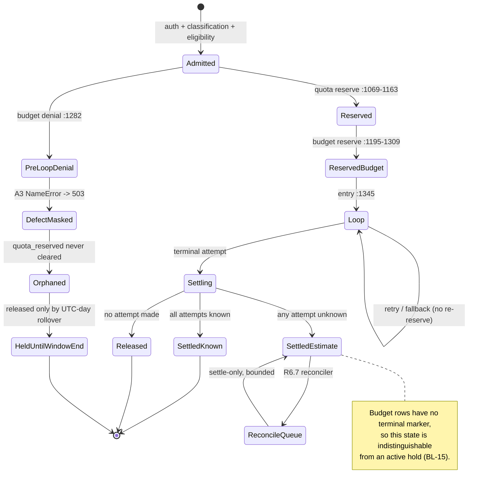
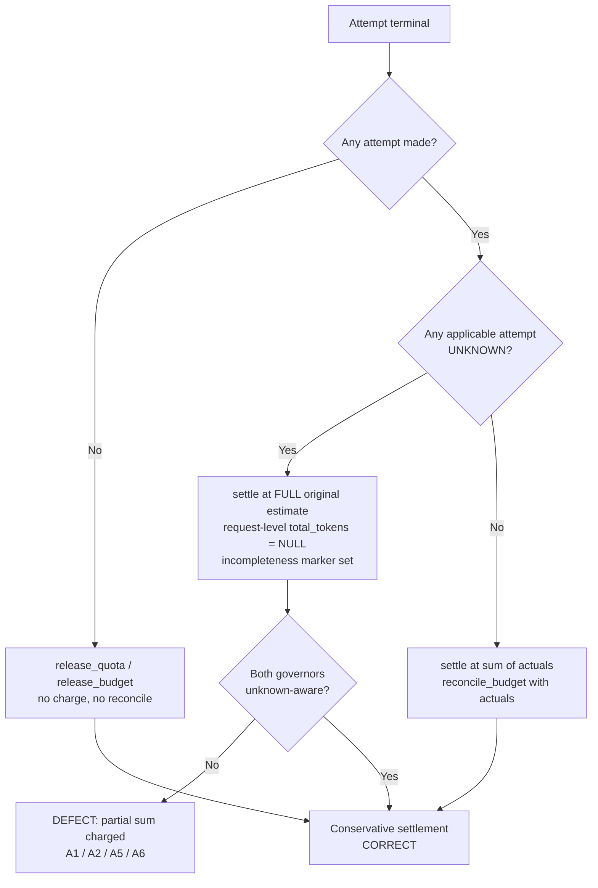
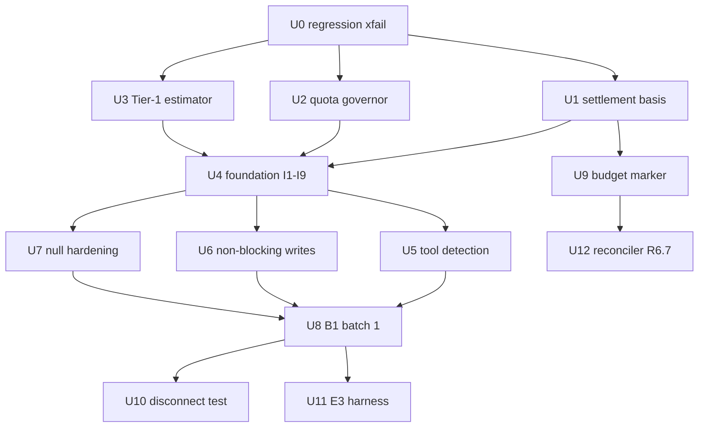

# R6 T12 — Accounting Integrity, R6.0 Gate Closure and U0 Authorization Preparation

**Status:** decision support only. **This report approves nothing, authorises no implementation, and grants no G7.**
**Mode:** read-only. No application source, test, config, migration, dataset or prior report was modified. No test was executed. No provider was called. No dependency was installed. Nothing was committed, pushed, staged, reset, cleaned, stashed or pruned.
**Baseline:** branch `feat/sabiroute-routing-foundation`, HEAD `319a711ef4142e6232a13f6e4bc7ec7fb74cdfaf`.
**Predecessors read in full:** R6 architecture decision pack, R6 decision-resolution campaign, T9, T10, T11.
**Evidence labels:** `VERIFIED` (read at HEAD, exact anchor) · `STATIC-ANALYSIS FINDING` (reachable by control flow; runtime consequence not executed) · `UNRESOLVED` · `NOT OBTAINED` (owner/external input absent — never assumed).

---

## 1. Executive Summary

T12 independently re-derived every load-bearing claim in T11's accounting audit and blocker register. The result is not a restatement: one T11 finding is **narrower** than stated, one is **wider**, one **new defect** was found in the same class, and four documentation defects that would otherwise be signed were confirmed.

**Accounting (Objective A).** All five T11 findings survive re-derivation. Verdicts:

| ID | Subject | T12 verdict |
|---|---|---|
| A1 | Unknown-usage detection is budget-gated | **CONFIRMED DEFECT** — and wider than T11 recorded |
| A2 | No-usage success is never flagged | **CONFIRMED DEFECT** — affects budget *and* quota paths |
| A3 | `finish()` reads `attempted` before binding (masked 503 + quota leak) | **CONFIRMED DEFECT** — highest severity; actively misreports to the caller |
| A4 | `cleanup_errors` / `ledger` written, never read | **CONFIRMED DEFECT** — dead observability |
| A5 | Mixed known/unknown settles the partial sum as complete | **CONFIRMED, WITH A PRECISION** — narrower: only the *mixed* case; all-unknown is correct |
| **A6** | **Client-cancel (499) attempt sets no unknown flag on *either* governor** | **NEW — CONFIRMED DEFECT** (found by T12, not in T11's register) |

**Gate closure (Objective B).** T12 resolves one blocker outright (BL-25), produces two decision-ready ADRs, and — the substantive movement — **reclassifies Track A sign-off and Terminal reconciliation from R6.0 gates to R6.1/release gates.** That is defensible: Track A reviews are per-unit sign-offs on code that R6.0 does not authorise, and Terminal B/C/D/E feed benchmark and red-team claims (G4/G5), which are release gates. R6.0's remaining conditions are therefore **owner-only and only three**.

**R6.0 status: CONDITIONALLY READY** — down from T11's six pending conditions to three owner-only ones (adopt ADR-1, adopt ADR-2, decide Groups A/B, then sign).

**R6.1 status: NOT READY for the whole programme; U0 is READY FOR SEPARATE OWNER AUTHORIZATION** with one condition neither T11 nor its predecessors identified — see below.

**The U0 finding that matters most.** T11 describes U0 as "test-only, four specs that fail today." A test-only unit whose tests fail **is not a mergeable green commit**, and the existing suite is green today. U0 must therefore either land alongside U1 or carry `@pytest.mark.xfail(strict=True)`. T12 recommends strict-xfail: the suite stays green, the defect becomes executable evidence, and *flipping the marker to strict-pass is the U1 acceptance signal*. This is a scope decision for the owner and is drafted as Group D1.

**Final status of this report:** `T12 COMPLETE — R6.0 CONDITIONALLY READY; OWNER OR EXTERNAL ACTIONS REMAIN.`

---

## 2. Verified Repository Baseline

Verified at the start of T12 by direct inspection.

| Fact | Value | Method |
|---|---|---|
| Branch | `feat/sabiroute-routing-foundation` | `git branch --show-current` |
| HEAD | `319a711ef4142e6232a13f6e4bc7ec7fb74cdfaf` | `git rev-parse HEAD` — **matches the expected baseline** |
| Tracking | `[ahead 6, behind 3]` of `origin/…routing-foundation` | `git status -sb` |
| Staged changes | none | `git diff --cached --stat` (empty) |
| Unstaged tracked changes | none | `git diff --stat` (empty) |
| Untracked | all six `docs/r6-*` reports, including T11 and the T12 draft | `git status --porcelain` |
| Worktrees | **6 registered**; 2 `prunable` (under `/private/tmp/`), none touched | `git worktree list` |

**Baseline fact the mission should record.** CLAUDE.md's verified state of 2026-10-10 states the branch is "in sync with origin (0 ahead, 0 behind)". It is now **ahead 6, behind 3**. T12 neither fetches nor reconciles; this is recorded because a diverged baseline invalidates any assumption that local HEAD equals remote HEAD, and every anchor in this report is against **local** `319a711`. Any investigator or reviewer working from a remote ref must re-anchor.

**Corpus integrity.** All five predecessor reports are present and non-trivial: pack 35,947 B · campaign 50,154 B · T9 96,860 B · T10 54,604 B · T11 69,543 B. None was modified.

---

## 3. T11 Findings and Blocker Register

T11 raised 32 blockers (BL-01…BL-32). T12 reconciled all 32 against HEAD; the full matrix with status, evidence class, smallest next action and R6.0/R6.1 impact is in **§13** so the closed items and the blockers appear together as one artefact.

Distribution after T12 reconciliation:

| Status | Count | Meaning |
|---|---|---|
| `OPEN` | 18 | Engineering work remains; no external input needed |
| `NEEDS-OWNER` | 10 | A named owner decision is required |
| `NEEDS-EXTERNAL` | 3 | Track A / Terminal / capability probe — `NOT OBTAINED` |
| `CLOSED` | 1 | BL-25, documentation-only |

**Blocking R6.0 (architecture freeze):** BL-16, BL-22, BL-26, and conditionally BL-31. T12 **removes BL-21 and BL-24 from the R6.0 critical path** (see §13 and §23).

**Blocking R6.1 (implementation):** 22 of 32 — all except BL-10, BL-11, BL-12, BL-13, BL-19, BL-24, BL-25, BL-28, BL-29, BL-30.

---

## 4. T12 Investigation Methodology

The mission planned six parallel investigators. **Five of six (A, B, D, E, F) terminated on transient HTTP 403 / model-busy errors and produced no report.** Per mission §2, the workstreams were **not** retried and **not** abandoned: their load-bearing claims were re-derived directly by the main agent at HEAD. One workstream (T12-C, gate closure and ADR synthesis) completed and its output was accepted **with three corrections** (§13.3).

This report therefore distinguishes two evidence grades, and states which applies:

| Grade | Meaning | Applies to |
|---|---|---|
| **T12 re-derived** | Read directly at HEAD during this mission | All five accounting verdicts; reservation idempotency; alias capability table; gate-namespace correction; U0 fixture feasibility |
| **T12-C accepted** | Produced by the one completed investigator, verified against HEAD where cited | Blocker register structure; ADR drafts; owner-decision bucketing |

Every claim below that is marked `VERIFIED` was read by the main agent at `319a711`. No claim rests on a worktree, branch or ref other than the verified HEAD.

**What T12 did not do:** it did not enumerate a full per-transition partial-persistence matrix, did not build a file-level U1–U12 mapping, and did not build a per-dimension B1 coverage table. Those gaps are stated in §26 rather than papered over.

---

## 5. Accounting Defect A1 — Unknown-usage detection is budget-gated

### Verdict: **CONFIRMED DEFECT** — and wider than T11 recorded

`provider_usage_unknown` is initialised `False` at `completions.py:1316` (VERIFIED). Its complete set-site inventory at HEAD:

| Site | Condition under which it becomes `True` | Gating |
|---|---|---|
| `:1572` | provider error carried a usage body whose **total is `None`** | **ungated** — correct |
| `:1574` | provider error carried **no usable usage body** | `elif budget_reserved:` — **budget-only** |
| `:1629–1630` | request deadline expired mid-attempt | `if budget_reserved:` — **budget-only** |
| ~`:1676–1684` | client cancelled → 499 path | **never set — no governor** |
| `:1693` | any other exception during the attempt | `budget_reserved or provider_usage_unknown` — **budget-conjoined** |
| `:1812` | streaming attempt ended non-successfully | `budget_reserved or provider_usage_unknown` — **budget-conjoined** |

**Consequence.** A request held by quota but not by budget — the Free Chat shape — never sets the flag on five of six paths, regardless of what the provider returned. T10's prescription ("pass the flag into `finish()`") is therefore insufficient on its own: the flag is **unset at source**, so passing it passes `False`.

**T12 widens T11.** T11 recorded three budget-gated sites. T12 additionally established the **client-cancel path sets the flag on neither governor** — it is not budget-gated, it is *entirely absent*. This is filed as **A6** (§9A) because it is a distinct control-flow hole with a distinct fix, not a restatement of A1.

**Reproduction method:** static control-flow inspection of every assignment and read at HEAD. **Confidence:** VERIFIED for the set-site inventory; STATIC-ANALYSIS FINDING for the settlement consequence (which depends on A5). **Residual uncertainty:** whether any provider adapter in the execution path can return a shape that reaches a set-site not enumerated above. Not exhaustively enumerated — the six sites above are those reachable from `chat_completions`.

---

## 6. Accounting Defect A2 — Successful responses with no usage

### Verdict: **CONFIRMED DEFECT** — affects both governors

The only success-adjacent set-site is `:1693` (non-stream) and `:1812` (stream), both of which evaluate `budget_reserved or provider_usage_unknown`. A 200 response carrying no usage object, no prompt-token field, no completion-token field, or a partial usage object therefore leaves the flag at its previous value. With no budget reservation that previous value is `False`, and settlement proceeds as if the attempt were fully known.

**The specific sequence that bites.** Budgeted attempt 1 fails with a real error body (known partial usage) → attempt 2 succeeds with no usage object → `:1693` leaves the flag `False` → `finish()` treats attempt 2 as known → the budget reconciles against the sum of attempt 1's actuals, discarding attempt 2's consumption entirely. This is T11 §7.6 item 5, and T12 confirms it is reachable on the **budget** path too, not only quota.

**Zero versus unavailable.** The codebase does **not** conflate them at the parse layer: `_actual_tokens` returns `None` for absent components and only synthesises a total when both prompt and completion are present. The conflation happens **one layer up**, at the flag, which is only consulted on budgeted paths. Genuine zero usage (`prompt=0, completion=0, total=0`) is distinguishable and is treated as known — correctly. T12 found **no documented provider contract** anywhere in the tree that licenses interpreting absent usage as zero; absent must remain unknown.

**Not asserted:** that every provider in the catalogue omits usage on success. `UNRESOLVED` — a provider-specific behaviour that would require the B2 measurement campaign. The defect is that the code **cannot detect it**, which is independent of whether it occurs.

---

## 7. Accounting Defect A3 — Pre-loop `NameError`, masked 503, quota leak

### Verdict: **CONFIRMED DEFECT** — highest severity of the six

**Exact reconstruction (VERIFIED, code read in full):**

1. `finish()` is defined at `:542` as a nested function of `chat_completions`.
2. Its quota branch opens `if quota_reserved and quota_user_id is not None:` at `:596`, then `try:` at `:601`, then reads `if attempted:` at **`:602`**.
3. `attempted` is bound at **`:1311`** — inside the loop-setup section, *after* every pre-loop exit.
4. Pre-loop `finish()` call sites that can reach `:602`: `:1180`, `:1189`, `:1205`, `:1272`, `:1282`, `:1291`, `:1299`.
5. `NameError` is a subclass of `Exception`, so it is caught by `except Exception as exc:` at `:621`, whose body:
   - logs `"Quota reservation could not be reconciled"`;
   - appends `"quota_cleanup_failed"` to `cleanup_errors`;
   - **overwrites the response object** with `_error_response(503, …, QUOTA_UNAVAILABLE)` at `:628–632`;
   - **never sets `quota_reserved = False`**, so the reservation is never settled or released.

**Consequence.** The defect is not "a crash." A legitimate pre-execution denial — a budget denial at `:1282`, an eligibility rejection, a Free Pool exclusion — is **silently converted into `503 QUOTA_UNAVAILABLE`**, the caller is told the wrong thing, and the quota hold is orphaned for the remainder of the UTC-day window. Every such request also consumes quota it never used.

**Compounding.** The failure signal is written to `cleanup_errors`, which is read nowhere (A4). So the mask is not merely misreported — it is *undetectable in production telemetry*.

**Reachability.** `STATIC-ANALYSIS FINDING`, conditionally reproducible: deterministic when a service key carries both a quota entitlement and a budget, and a budget denial fires. T12 confirmed **no existing test combines quota admission with budget denial** — `quota_unavailable` is asserted only in `tests/test_user_quotas.py:320,354` and `tests/test_quota_summary.py:109,183`, none of which route through the pre-loop budget-denial exit. This is why the defect is live and green.

**Severity:** CRITICAL. It is the only finding among the six that **actively misreports to the caller** and **orphans state**.

**Smallest safe correction (not implemented):** bind `attempted` at admission, alongside `quota_reserved` — a one-line control-flow correction. The usage-state and settlement corrections (A1/A2/A5/A6) are separate and larger. **This ordering matters:** A3 should be sequenced first, ahead of A1/A5, because it is cheap and it removes a false signal that would otherwise contaminate every regression test written for the others.

---

## 8. Accounting Defect A4 — Dead `cleanup_errors` and ledger

### Verdict: **CONFIRMED DEFECT**

Re-derived repo-wide at HEAD, with an earlier mis-fired grep corrected (see §26.2):

| Symbol | Declared | Written | Read |
|---|---|---|---|
| `cleanup_errors` | `completions.py:406` | 9 sites: `:590, :627, :706, :721, :805, :825, :1127, :1243, :1264` | **zero** — the only other hits in the file are comments (`:687`) |
| `ledger` | `completions.py:403` | `:1163` (quota), `:1309` (budget) | **zero** — `_compensate_all` (`:681–721`) uses the boolean flags, not the ledger |

Repo-wide search outside `completions.py`: `cleanup_errors` → **zero hits**. `ledger` → hits exist but every one is unrelated (`store.py` migration names such as `"0004-user-quota-ledger"`, and test assertions on `applied_revisions`). **No consumer exists for either symbol.**

**Why this is not cosmetic.** Two consequences compound with A3:

1. **Every cleanup failure is silent.** Nine distinct failure conditions — budget cleanup, quota cleanup, snapshot persistence — record into a list nothing reads. There is no metric, no admin surface, no log line sourced from it.
2. **The ledger was designed to be the compensation driver and never became one.** The comment at `:393–401` describes "every database mutation that must be compensated"; the entries are appended at `:1163`/`:1309` and then abandoned. `_compensate_all` therefore compensates from flags, which is correct-by-luck today but does not generalise if a third reservation-bearing mechanism is added.

**Fix direction is not "delete".** The ledger is the natural source for the reconciler (BL-15/U12) and the natural sink for admin visibility (BL-05, U9). T11 classifies BL-05 as `R6.1 (ops)`; T12 agrees and adds that **wiring is a prerequisite for any reconciler**, because a reconciler that cannot report per-pass counters is not auditable.

**No fix implemented.** Recorded as a specification only.

---

## 9. Accounting Defect A5 — Mixed known/unknown settlement

### Verdict: **CONFIRMED, WITH A PRECISION** — narrower than T11 stated

T11 framed this as "quota settlement ignores unknown usage." T12 re-derived the arithmetic and the defect is **materially narrower**, which changes the fix.

`_sum_actual_tokens` (`:253–264`, VERIFIED in full) collects only non-`None` components per column and sums them; a column with no non-`None` values yields `None`; and if total is `None` while prompt and completion are both known, it synthesises `prompt + completion`.

| Attempt set | `_sum_actual_tokens(...)[2]` | `settle_quota` behaviour | Correct? |
|---|---|---|---|
| All known | correct sum | charges sum | **yes** |
| All unknown | `None` | holds estimate (documented conservative branch) | **yes** |
| **Mixed** (e.g. `(100,50,150)` then `(80,None,None)`) | **`150` — a partial sum** | charges 150 as if complete; releases the remainder of the hold | **NO** |

So: **all-unknown is correct; the hole opens only on a mix.** This is why an existing test (`test_unknown_usage_holds_estimate`, `tests/test_user_quotas.py:187`) passes and gives false comfort — it exercises the all-unknown case, which was never broken.

**The sharpest evidence is the asymmetry with the budget path.** `finish()`'s budget branch computes `actual_cost` via `_actual_cost(..., has_unknown_usage=provider_usage_unknown)` (`:1984–1986`), which returns `None` whenever the flag is set — a correct conservative result. **The budget path honours unknown-ness wherever the flag is set; the quota path cannot, because it is passed no flag at all.**

**Why "pass the flag into `finish()`" is not sufficient.** Because A1 establishes the flag is budget-gated at source, passing it into the quota branch passes `False` for every quota-only request. A5's fix therefore **depends on A1's fix**; they are not independently shippable in the quota direction. This is the single most important sequencing consequence in the accounting set.

**Reproduction:** arithmetic re-derived from the function body; mixed-sequence consequence is `STATIC-ANALYSIS FINDING` (not executed). **Confidence:** high — the function is ~12 lines and read in full.

---

## 9A. Accounting Defect A6 (NEW) — Client-cancel attempt sets no unknown flag

### Verdict: **NEW — CONFIRMED DEFECT** (not in T11's register)

The `client_cancelled` branch (HTTP 499) at `:1676–1684` calls `finish(... tokens=(None, None, None) ...)` and **sets `provider_usage_unknown` on no path whatsoever** — not budget-only, not budget-conjoined, not ungated. It simply does not appear.

This is materially different from A1. A1 is "the flag is gated behind the wrong governor." A6 is "the flag is absent entirely on a branch that consumed provider tokens when the client disconnected mid-flight."

**Why it matters.** The 499 branch is the *normal* code path for a client disconnect that is not a deadline expiry. After A1's fix — a budget-independent `any_attempt_unknown` — this branch would still need to participate, and the current code gives a later fixer nothing to hook onto. It is therefore an A1-fix-scope item, not a separate unit.

**Note on the `tokens` argument.** `finish()`'s `tokens` parameter feeds the **telemetry event** (`final_event = replace(event, …, total_tokens=tokens[2], …)` at `:633+`), **not** the quota settlement, which reads `actual_usage_parts`. Passing `(None, None, None)` therefore makes the event correct while leaving settlement wrong. A reader who assumed the `tokens` parameter drove settlement would conclude this branch is safe. It is not.

---

## 10. Adversarial Accounting Test Matrix

Twenty scenarios, each with the expected invariant and the current-behaviour verdict. **Expected** columns state what a correct system must do; **Verdict** states what this system does at HEAD.

Legend: `EST` = original reservation estimate retained · `ACT` = sum of complete actuals · `NULL` = no fabricated value · `REL` = released, no charge.

| # | Scenario | Reservation expected | Usage expected | Settlement expected | Quota expected | Budget expected | Telemetry expected | Retry expected | Recon expected | Verdict at HEAD |
|---|---|---|---|---|---|---|---|---|---|---|
| 1 | Single attempt, complete usage | held→settled | complete | ACT | charge ACT | reconcile ACT | actuals recorded | n/a | none | **CORRECT** |
| 2 | Single attempt, missing usage | held→settled | unknown | **EST** | charge EST | hold EST | NULL + unknown marker | none | eligible | **DEFECT** (A2/A5): budgeted path treats as known |
| 3 | Single attempt, partial usage | held→settled | unknown | **EST** | charge EST | hold EST | NULL + marker | none | eligible | **DEFECT** (A2) |
| 4 | Multiple attempts, all known | held→settled | complete | ACT | charge ACT | reconcile ACT | actuals | as needed | none | **CORRECT** |
| 5 | First known, second unknown | held→settled | unknown | **EST** | charge EST | hold EST | NULL + marker | none | eligible | **DEFECT** (A5): quota charges partial sum 150 |
| 6 | First unknown, second known | held→settled | unknown | **EST** | charge EST | hold EST | NULL + marker | none | eligible | **DEFECT** (A5 + A1: quota-only never sets flag) |
| 7 | Multiple attempts, all unknown | held→settled | unknown | EST | charge EST | hold EST | NULL | none | eligible | **CORRECT** (`test_unknown_usage_holds_estimate`) |
| 8 | Quota-only, unknown usage | held→settled | unknown | **EST** | charge EST | n/a | NULL + marker | none | eligible | **DEFECT** (A1: flag never set) |
| 9 | Budget-only, unknown usage | held→settled | unknown | EST | n/a | hold EST | NULL + marker | none | eligible | **CORRECT** only when a set-site fires; **DEFECT** on success-without-usage (A2) |
| 10 | Quota + budget, unknown usage | held→settled | unknown | EST | charge EST | hold EST | NULL + marker | none | eligible | **CORRECT** on the failure paths that set the flag; **DEFECT** on cancel (A6) |
| 11 | Success with no usage object | held→settled | unknown | **EST** | charge EST | hold EST | NULL + marker | none | eligible | **DEFECT** (A2) |
| 12 | Streaming without final usage | held→settled | unknown | **EST** | charge EST | hold EST | NULL + marker | none | eligible | **DEFECT** (`:1812` budget-conjoined) |
| 13 | Streaming disconnect | held→settled | unknown | EST | charge EST | hold EST | NULL | none | eligible | **UNRESOLVED** (`GeneratorExit`, BL-14) — `finish()` may not run at all |
| 14 | Provider timeout | held→settled | unknown | EST | charge EST | hold EST | NULL | retry if budget remains | eligible | **PARTIAL** — deadline branch sets flag budget-only (`:1629`) |
| 15 | Cancellation during an attempt | held→settled | unknown | **EST** | charge EST | hold EST | NULL | none | eligible | **DEFECT** (A6): no flag on 499 path |
| 16 | Exception after reservation, before provider | held→**released** | none | REL | **REL, no charge** | REL, no charge | none | none | none | **DEFECT** (A3): `NameError` → masked 503 + orphaned hold |
| 17 | Settlement persistence failure | held (identifiable) | n/a | fail-closed | EST held | EST held | marker + 503 | none | **must pick up** | **GAP** — 503 raised; row identifiable only after the BL-15 marker |
| 18 | Duplicate settlement | settled once | n/a | idempotent no-op | no double charge | no double reconcile | single terminal | n/a | none | **CORRECT** (`status` guard + `final_status IS NULL`) |
| 19 | Reconciliation after process interruption | recoverable | n/a | settles in bounded pass | within window | within window | counters | n/a | **required** | **GAP** — no reconciler exists; budget rows indistinguishable from active holds (BL-15) |
| 20 | Repeated fallback and retry | held once, no re-reserve | accumulating | EST if any unknown | charge EST | hold EST | per-attempt rows | bounded | eligible | **PARTIAL** — no re-reserve is correct; unknown accumulation is defective per A1/A5 |

**Summary.** Correct today: **5 of 20** (1, 4, 7, 18, and 9 on budgeted failure paths). Defective: **10**. Partial/gap: **3**. Unresolved: **1**.

**These are not 20 defects.** The matrix is the evidence that the defects are **four root causes** — A1 (gating), A2 (success path), A3 (pre-loop binding), A5 (mixed settlement) — plus A6 (cancel path) and A4 (unobservable failure). Ten failing scenarios collapse to five code changes.

---

## 11. Reservation Lifecycle

### 11.1 Stage inventory and owners

Twelve stages, each with its owner (the module that performs the transition) and idempotency requirement. **T12-derived from code, not inherited.**

| # | Stage | Owner | Transition | Idempotent? |
|---|---|---|---|---|
| 1 | Reservation creation (quota) | `completions.py:1069–1163` → `store.check_and_reserve_quota` | none → `reserved` | yes (`reserved`-only) |
| 2 | Reservation creation (budget) | `completions.py:1195–1309` → `store.reserve_budget` | none → row | yes by PK |
| 3 | Hold confirmation | `quota_reserved=True` `:1161`; `budget_reserved=True` `:1308` | in-process flags | n/a |
| 4 | Provider attempt | `:1345` loop → `:1520`/`:1539` | unchanged reservations | n/a |
| 5 | Usage recording | `_record_usage`, `_actual_tokens` | accumulates `actual_usage_parts` | append-only |
| 6 | Retry | `:1601` retryable gate | **no re-reserve** — correct | n/a |
| 7 | Fallback | `:1397` continue → next candidate | **no re-reserve** — correct | n/a |
| 8 | Completion | loop exit or terminal `finish()` | → settlement | n/a |
| 9 | Settlement (quota) | `store.settle_quota` `:1343–1390` | `reserved → settled` | **yes** (`FOR UPDATE`, status guard) |
| 10 | Settlement / release (budget) | `store.reconcile_budget` `:1213–1247`, `release_budget` `:1249–1256` | **no terminal marker** | release yes (delete); reconcile **not guarded** |
| 11 | Release (quota, unattempted) | `store.release_quota` | `reserved → released` | **yes** |
| 12 | Recovery after crash | **no owner** | — | **absent** |

### 11.2 The three-way asymmetry (the decisive finding)

| Store object | Terminal marker | Idempotency mechanism | Verdict |
|---|---|---|---|
| `_QUOTA_RESERVATIONS` (`store.py:127`) | `status` ∈ `reserved → settled/released` | `SELECT … FOR UPDATE` filtered on `status == "reserved"` + guarded `UPDATE` | **CORRECT pattern** |
| `_REQUEST_USAGE` (`store.py:65`) | `final_status` | `finalize_usage_event` updates only `WHERE final_status IS NULL`; `rowcount == 1` proves exactly-once (`:1501–1523`) | **CORRECT pattern** |
| `_BUDGET_RESERVATIONS` (`store.py:433`) | **none** | release = unconditional `DELETE`; reconcile = unguarded absolute `UPDATE` | **GAP (BL-15)** |

Verified at HEAD: `_BUDGET_RESERVATIONS` has columns `request_id, key_id, window_kind, window_start, reserved_tokens, accounted_tokens, estimated_cost_usd, accounted_cost_usd, created_at, lineage_id` — **no `status`, no `updated_at`**.

Consequences, each verified by reading the functions:

- `release_budget` deletes by primary key. Idempotent **by accident** (no row ⇒ no-op), and it **destroys the audit trail** — a released-then-settled race leaves no evidence.
- `reconcile_budget` writes absolutes only when actuals are non-`None`. With `actual_tokens=None` **and** `actual_cost_usd=None` — precisely the unknown-usage case — it performs **no update at all**, leaving `accounted_tokens` unchanged and the row present.
- Therefore **after an unknown-usage settlement a budget row is indistinguishable from an active hold.** A reconciler cannot be written safely against this schema.
- `settle_quota` and `release_quota` (`:1343–1432`) are genuinely race-safe: `reserved`-only transitions under `FOR UPDATE`; a racing release never touches a settled row.

### 11.3 Lifecycle diagram

### 11.4 Transitions that must be idempotent

Creation under duplicate request-id; settle under duplicate delivery; release after settle; settle after release; reconciler replay. **Quota and usage already satisfy all five. Budget satisfies creation and release, and fails "reconcile after release" and "settle after reconcile"** because neither carries a marker.

### 11.5 Smallest maintainable answer

**No new recovery component is justified.** The correct pattern already exists twice in `store.py`. BL-15's fix is a **pattern transfer**: mirror `_QUOTA_RESERVATIONS.status` onto `_BUDGET_RESERVATIONS` as an additive column (`held → settled | released`) plus `settled_estimate`, and rewrite `reconcile_budget`/`release_budget` as `status`-guarded transitions under `FOR UPDATE`. An unknown-usage settle becomes `status='settled'` with `accounted_tokens` left `NULL` — distinguishably *unknown*, rather than indistinguishable-from-held. The reconciler itself stays in R6.7.

**Not established:** a per-transition failure-mode matrix (which transitions can partially persist). The stage inventory above is derived, but partial-persistence analysis is `UNRESOLVED` and belongs to U12's design.

---

## 12. Accounting Contract

A precise contract, stated as invariants. **Proposed for adoption in Group B; nothing here is implemented.**

### 12.1 Usage states

| State | Definition | Settlement basis |
|---|---|---|
| **KNOWN COMPLETE** | Every applicable attempt for the logical request reported a trustworthy `total_tokens` (or both prompt and completion) | Sum of actuals |
| **UNKNOWN / INCOMPLETE** | At least one applicable attempt lacks trustworthy usage — missing body, missing prompt, missing completion, partial object, cancel, deadline, exception, stream without usage, success without usage, disconnect | **Full original estimate. Unknown wins.** |
| **ESTIMATED** | The reservation-time estimate, retained as the conservative fallback | Only ever via the UNKNOWN branch — never blended with actuals |
| **RECONCILED** | A later bounded reconciler observed evidence and settled | Bounded, auditable, counters emitted |

**Prohibited:** treating a partial sum of known attempts as complete actuals; treating absent usage as zero; fabricating, zero-filling, or inferring usage; blending estimated and actual within one settlement.

### 12.2 Settlement decision (required behaviour)

**Current divergence:** the quota path has no node D. It reaches F unconditionally whenever `_sum_actual_tokens` returns non-`None`, which includes the mixed case. The budget path has node D but only where the flag was set — which A1 and A6 show is a proper subset of the required set.

### 12.3 Contract clauses

| # | Clause |
|---|---|
| C1 | One quota and one budget reservation per **logical** request, created pre-execution; retries and fallbacks never re-reserve. |
| C2 | Reservation ownership is the request, not the attempt. Attempt-level usage is recorded, never independently settled. |
| C3 | Attempt-level usage records are append-only and survive settlement. |
| C4 | Settlement is a single terminal transition per reservation, guarded by a terminal marker. |
| C5 | Unknown-ness is a property of the **attempt**, recorded independently of which governor happened to be armed. |
| C6 | Any unknown attempt ⇒ settle at the full original estimate. Unknown wins over partial evidence. |
| C7 | Unknown usage enters a bounded, auditable reconciliation path with an owner, per-pass counters and admin visibility. |
| C8 | Idempotency keys: `request_id` for both governors; the terminal marker makes replay a no-op. |
| C9 | Reservation expiry follows the governor's own window (quota: UTC day; budget: its window). **No arbitrary TTL release.** |
| C10 | Audit events: creation, settle, release, reconciliation, failure — each with request_id, governor, basis and a counter. |
| C11 | Partial persistence failure fails **closed**: the hold remains, is identifiable, and the client receives a real error — never a masked success and never a fabricated zero. |
| C12 | Every pre-execution exit releases. No path may terminate with a held reservation and a misreported status. |

**New ledger or migration?** Not required for C1–C12 except **one additive column set** on `_BUDGET_RESERVATIONS` (BL-15), which is a **Track A** change (§16, T7) with an approval dependency. T12 explicitly does **not** propose a new ledger table.

**Classification of the smallest safe correction:** a **combination**, sequenced — (1) control-flow correction (A3, one line), (2) usage-state correction (A1/A2/A6, one attempt-level flag), (3) settlement correction (A5, quota branch consumes the flag), (4) reservation-state correction (BL-15 marker), (5) reconciliation correction (R6.7). Items 1–3 are the accounting-defect fix; 4 is its precondition for auditability; 5 is deferred.

---

## 13. R6.0 Blocker Closure

### 13.1 Consolidated blocker matrix (32 rows)

Status: `OPEN` = engineering work remains · `NEEDS-OWNER` · `NEEDS-EXTERNAL` · `CLOSED`.
Evidence: `SUF` = defect reproduced / spec actionable · `PART` · `ERR` = the blocking claim itself was wrong.

| ID | Subject | Status | Evid. | Smallest next action | Blocks R6.0 | Blocks R6.1 |
|---|---|---|---|---|---|---|
| BL-01 | Quota partial settlement (mixed known/unknown) | OPEN | SUF | U0; flag into `finish()` quota branch | No | **Yes** |
| BL-02 | Unknown detection budget-gated | OPEN | SUF | Budget-independent `any_attempt_unknown` at every attempt outcome | No | **Yes** |
| BL-03 | No-usage success never flagged | OPEN | SUF | Flag on success-without-usage | No | **Yes** |
| BL-04 | `finish()` reads `attempted` before binding | OPEN | SUF | Bind `attempted` at admission — **sequence first** | No | **Yes** |
| BL-05 | `cleanup_errors` / `ledger` dead | OPEN | SUF | Wire to admin/metrics; prerequisite for reconciler | No | **Yes** (ops) |
| BL-06 | Quota token governor absent | OPEN | SUF | Mirror the budget governor behind `quota_reserved` | No | **Yes** |
| BL-07 | Tier-1 quota extras parity + `quota_request_unsupported` | OPEN | SUF | Gap closure + distinct error type + suite | No | **Yes** |
| BL-08 | In-message tool-key detection | OPEN | SUF | Syntactic detector + bypass-direction tests | No | **Yes** |
| BL-09 | Role-aware system/developer freeze | NEEDS-OWNER | PART | Ruling B5/C3, then byte-diff tests | No | Partial |
| BL-10 | Capability verification `tool_use`/`structured_output` | NEEDS-OWNER | SUF | **Extend the proven 2026-10-08 probe** — a known procedure, not new design (§21) | No | No |
| BL-11 | SDK-coupling exception evidence | OPEN | SUF | Sandbox `import litellm` timing + env-diff | No | No |
| BL-12 | `compress()` null-crash runtime proof | OPEN | SUF | Target the **transform** path, not `budgets.py` (§21) | No | No |
| BL-13 | Service-key budget row | OPEN | SUF | Config/admin read | No | No |
| BL-14 | Streaming `GeneratorExit`, no `BaseException` arm | OPEN | PART | Disconnect test vs fake ASGI; fix needs Track A | No | **Yes** (test must exist) |
| BL-15 | Budget reservation has no terminal marker | OPEN | SUF | `status` + `settled_estimate` — pattern transfer (§11.5) | No | **Yes** (reconciler) |
| BL-16 | Telemetry Option A freeze must be conditional + not-implemented | NEEDS-OWNER | SUF | **Adopt ADR-1 (§14)** | **Yes** | Partial |
| BL-17 | Non-blocking write convention + failure-proof test | OPEN | SUF | Convention spec + telemetry-failure test | No | **Yes** |
| BL-18 | Null-content hardening for pre-provider transforms | OPEN | SUF | Crash fixtures in B1 + guard code | No | **Yes** |
| BL-19 | Multilingual scoring + adversarial corpus | NEEDS-EXTERNAL | PART | Terminal D corpus; exclude non-Latin until proven | No | No |
| BL-20 | E3 integrity harness + R6.1 B1 subset | OPEN | SUF | Build under R6.1 authorisation | No | **Yes** |
| BL-21 | Track A sign-off T1–T8 | NEEDS-EXTERNAL | PART | **Converge T-numbering (§13.3), then issue** | **Reclassified: No** | **Yes** |
| BL-22 | Owner written R6.0 architecture approval | NEEDS-OWNER | SUF | §22 Group A, then sign | **Yes** | **Yes** (gates G7) |
| BL-23 | G7 separate R6.1 implementation authorisation | NEEDS-OWNER | SUF | G7 request after BL-22 | No | **Yes** |
| BL-24 | Terminal B/C/D/E reconciliation | NEEDS-EXTERNAL | SUF | Re-issue campaign §13 prompts | **Reclassified: No** | No |
| BL-25 | T10 "18 invariants (§7)" wrong pointer | **CLOSED** | SUF | None — T11 §16 mapping authoritative | No | No |
| BL-26 | No adoptable R6.1 foundation contract | NEEDS-OWNER | **ERR** | **Adopt ADR-2 (§15)**; correct the "absent doc" claim (§13.3) | **Yes** | **Yes** |
| BL-27 | Scope: `/v1/chat/completions` only, or `api/chat.py` too | NEEDS-OWNER | SUF | Ruling B2 | No | **Yes** |
| BL-28 | B2 unmeasured; no pricing | OPEN | SUF | Paired-row census + pricing decision | No | No (claims only) |
| BL-29 | Proxy `tools`/`response_format` forwarding fidelity | OPEN | SUF | Proxy version/config read | No | No |
| BL-30 | byok/paid semantics + billing-source scope | NEEDS-OWNER | SUF | Owner conversation (C1) | No | No |
| BL-31 | Phase-13 interaction: transform metadata in telemetry | NEEDS-OWNER | SUF | Keep-out ruling (B4) | Conditional | **Yes** |
| BL-32 | Bypass authority: operator-only vs trusted-service | NEEDS-OWNER | SUF | Authority ruling (B3) | No | **Yes** |

### 13.2 The reclassification that unblocks R6.0

T11 listed BL-21 (Track A) and BL-24 (Terminal) as R6.0 blockers. T12 disagrees, on evidence in the predecessors:

- **BL-21** is a matrix of per-unit sign-offs on `completions.py`, `gateway.py`, `main.py`, `config/validation.py`, `store.py` and migrations (T11 §15). Every row is a change R6.0 does not authorise. Track A reviews **code that will be written**, so its absence cannot block approval of an architecture that authorises nothing.
- **BL-24** feeds Terminal reports that establish benchmark and red-team claims — G4 and G5, which are **release gates** by T9:417's own definition. They do not bear on whether §§8–15 is the right architecture.

Consequently R6.0's critical path narrows to: **BL-16 (ADR-1 adopted), BL-26 (ADR-2 adopted), BL-22 (signature)**, with BL-31 conditional on the Phase-13 ruling.

### 13.3 Corrections to predecessor documents

Five documentation defects, all confirmed by direct reading. **None overturns a T11 engineering verdict.** Each must be fixed before the freeze package is signed, because three would otherwise be signed as fact.

**X-1 · BL-26 cites a false fact.** T11 §8 states `docs/compression-discovery-packet.md` is **absent**. It is present (8,645 bytes). Campaign §2.1 correctly lists it. BL-26's *substance* survives — the document is a CD1–CD6 discovery packet, not a foundation contract — but the evidence sentence must be replaced, and ADR-2 must carry the naming conflict.

**X-2 · T12-C's own G-identifier finding is wrong.** T12-C's "Correction X-2" asserted that no set defines the R6 meanings of G4/G5/G7. **That is false.** The meanings are defined, consistently, in two documents — verified at HEAD:

- `docs/r6-t9-capability-recovery-review.md:417` — "Release gates G4 (benchmark — needs Terminal D), G5 (red-team — stays blocked pending D6/D8 corrections), G7 (implementation authorization — cannot be requested by this report)".
- `docs/r6-decision-resolution-and-approval-campaign.md:332` — identical meanings.

The real defect is a **namespace collision**, not a governance gap: the R6 scale (G4/G5/G7) collides with `SabiRoute_Developer_Workflow_Overhaul_Plan.md`'s remediation scale (G4 = deadline/retries, G5 = async lifecycle, G7 = deployment/security) and with `reports/remediation-roadmap-and-gates.md`'s gates A–E. Corrected statement: **three overlapping gate namespaces exist; R6's G4/G5/G7 are defined twice and unambiguous in context, but no single register disambiguates them.** This *strengthens* BL-23's actionability (G7 scope is already specified) and reduces T11 §19 criterion 17's note from "definitions to be supplied" to "a disambiguating register is required."

**X-3 · Track A numbering has not converged.** Campaign §15: T1–T7 where **T7 = "no dataset/migration change in v1"**. T10 §18: T1–T7 plus an unnamed "Tier 1 estimator". T11 §15: T1–**T8** where **T7 = D23 settlement fix + reconciler**, T8 = Tier-1 estimator. Two meanings for T7 across three documents. **BL-21 cannot be issued until one numbering is fixed** — an ambiguous T7 would have the reviewer sign off on the wrong artefact. T12 adopts **T11 §15's T1–T8** as the working numbering and recommends it for owner confirmation (D5).

**X-4 · T11 §1 contradicts T11 §4/§18/§19.** §1 omits BL-16 and BL-26 from the R6.0 blocker list though §4 and §19 mark both R6.0-blocking. §1 also claims "12 questions (§18)"; §18 enumerates **15** (A1–A4, B1–B5, C1–C3, D1–D3). Two rulings that §6 requires (monotone-shrink permanence; per-attempt re-derivation forbidden) are not enumerated at all, taking the real total to 17 (T12 adds them as B6/B7).

**X-5 · "All 14 aliases UNKNOWN" is false.** Verified at HEAD in `config/config.yaml`: **14 aliases** (`model_name` at `:22, :46, :72, :98, :110, :122, :134, :147, :160, :185, :197, :209, :221, :233`); `&unverified_capabilities` anchored at `:27` and referenced by **10** aliases; **three** carry `chat: true` on dated evidence:

| Alias | Declared | Capability line | Verified capability |
|---|---|---|---|
| `sabiroute-gemini` | `:46` | `:54` | `chat: true` — dated comment "Runtime-verified 2026-10-08: non-empty text completion" |
| `sabiroute-groq` | `:72` | `:80` | `chat: true` **and `streaming: true` (`:88`)** — "non-empty completion **and incremental SSE**" |
| `sabiroute-openrouter` | `:160` | `:167` | `chat: true` — dated 2026-10-08 comment |

Corrected ladder statement: **11 aliases fully UNKNOWN · 3 aliases BOUNDED for `chat` · 1 of those BOUNDED for `chat` + `streaming` · all 14 remain UNKNOWN for `tool_use` and `structured_output`.** This matters twice: it is a factual error in a document heading for signature, and it **narrows BL-10** from a from-scratch programme to a repeat of an established procedure.

---

## 14. ADR Draft 1 — Telemetry: Option A as a conditional, explicitly-not-implemented target

**Status: PROPOSED. Records no implementation. Adopting it is Group A decision A3.**

**Context.** T10 §15 selected Option A (a separate content-free table) *conditionally*. T11 §14.5 verified the live system is its opposite: inline JSON columns on `sabiroute_request_usage` (`store.py:65–88`), synchronous awaited writes on the response path, fail-closed semantics — the shape T10 rejected. Startup validation compounds it: `_REQUIRED_COLUMNS[_REQUEST_USAGE]` (`store.py:711`) demands exactly `{request_id, key_id, project_id, created_at, final_status}` and **no telemetry column**, so an unmigrated database passes startup and fails at first snapshot.

**Decision (proposed).**
1. **Target, frozen:** separate content-free table (working name `sabiroute_optimization_records`), PK `(request_id, attempt_number)`, `key_id` + `project_id` NOT NULL, scalar/enum/id columns only, `extra="forbid"` frozen builder.
2. **The target is explicitly NOT IMPLEMENTED** at `319a711`: no table, builder, projection or writer exists.
3. **Interim, named:** inline synchronous fail-closed telemetry on the accounting row is the production behaviour and must be described as such in any release note. It is not the target and must not be documented as though it were.

**Prerequisites, all currently unmet.**
- **P1** Non-blocking write convention built and failure-proof-tested *before* any optimisation write (BL-17).
- **P2** A `key_id`-write predicate mirroring `finalize_usage_event`'s tenant guard (`store.py:1515–1519`) — snapshot append is currently request_id-only.
- **P3** Additive-only migration following `_SCHEMA_VERSIONS`.
- **P4** Extend `_REQUIRED_COLUMNS` so an unmigrated database **fails at startup** rather than at first snapshot.
- **P5** The full-row admin projection must never gain optimisation columns.

**Tripwires to freeze:** schema-1.1 literal and `extra="forbid"` on all three models; per-request immutability; feature/outcome agreement; timezone provenance; attempt ordering; count equality; deployment-set membership; `FOR UPDATE` snapshot append; additive-only migrations; P4's startup check.

**Scope effect.** None for R6.1 (I4 emits nothing; BL-31 keep-out). Substantial for R6.7 — it fixes table shape, the P1 dependency and P4. If P1 slips, Option A reverts to conditional-with-no-schedule and must be recorded as such rather than silently dropped.

---

## 15. ADR Draft 2 — Adopt T11 §8 (I1–I9) as the draft R6.1 foundation contract

**Status: PROPOSED. Authorises no code. Adopting it is Group B decision B1.**

**Context.** BL-26 requires an adoptable contract. T11 §8 derives nine interfaces from the verified lifecycle: admission `:374` → classification `:966` → eligibility `:1166` → quota `:1069–1163` → budget `:1216–1309` → **insertion** → loop `:1345`. **Zero** transform vocabulary exists in `src/` today — no `request_transform` / `effective_messages` / `CanonicalRequest` / `OptimizationPolicy` symbol, and no transform package (VERIFIED by symbol and directory search).

**Decision (proposed).** Adopt I1–I9 as the **draft** contract, with these elements fixed:

| Element | Proposed value | Basis |
|---|---|---|
| Scope | `/v1/chat/completions` only; `api/chat.py` (own admission + store surface) **excluded** | BL-27 / B2 |
| Placement | constructed **once**, immediately before loop entry `:1345` | T11 §8.3 |
| Load-bearing invariant | **monotone-shrink**: effective output ≤ original on every path; no expansion knob | I3 / I5 |
| Per-attempt rule | **re-derivation forbidden**; fallback reuses the effective object | I3 / D12 |
| Phase-13 keep-out | R6.1 emits **no** snapshot fields; schema-1.2 deferred | I4 / BL-31 |
| Bypass authority | **OPEN** — recommended operator-only, per-route, default-off | B3 |
| Failure semantics | any I1–I8 exception ⇒ fail-to-original; never 4xx, never partial; `CancelledError` propagates | I8 / I9 |
| Package | new `src/sabiroute/request_transform/` — value objects + pure functions, no registry, no I/O | T11 §8.2 |

**Conflicts to reconcile before adoption — none fatal.**

- **C-1 (naming).** `docs/compression-discovery-packet.md` **exists** and names `src/sabiroute/compression/` with a policy-mode registry (`off/lite/standard/aggressive/ultra/rtk/stacked`). T11 names `request_transform/` with a single `OptimizationPolicy`. One name must win; **the mode registry is not R6.1 scope** and its presence in the packet is discovery-phase material, not a contract.
- **C-2 (insertion point).** CD2's "after final deployment selection" is **superseded**: selection is `choose_deployment` inside the loop, so adopting CD2 literally forces per-attempt transformation and breaks D12.
- **C-3 (statuses).** CD4/CD6 (`changed`/`unchanged`/`fallback` + reason; correlation ids) are compatible with I4 — fold in rather than re-derive.
- **C-4 (unwritten bounds).** I2's 250 ms / 2× byte budget is still unspecified; I5's config schema is described, not written.

**Two rulings §18 omits that ADR-2 depends on** and that must be added to Group B: monotone-shrink **permanence** (recommended: never expand without re-baselining the reservation) and per-attempt re-derivation (**recommended: forbid**). T12 adds them as B6 and B7.

**Scope effect.** This *is* the R6.1 scope definition. It fixes the package, file list, U4 unit, Track A surface and the Phase-13 keep-out, and it **narrows** rather than widens: excludes `api/chat.py`, registries, provider adapters and all telemetry writes.

---

## 16. Track A Approval Matrix

External approval, **NOT OBTAINED**. No reviewer identity, availability or cadence is invented anywhere in this section.

Protected surface (campaign §15, corrected paths): `src/sabiroute/api/completions.py`, `src/sabiroute/gateway.py`, `main.py`, `config/validation.py`, `src/sabiroute/security/store.py`, migrations, dataset-related files. All verified present at HEAD.

| Approval | Required for | Evidence | Current status | Blocks |
|---|---|---|---|---|
| Owner architecture approval | R6.0 freeze | Written decision (BL-22) | **NOT GRANTED** | R6.0 |
| Track A approval | Sensitive source changes (T1–T8) | External review sign-off | **NOT OBTAINED** | R6.1 start |
| Terminal reconciliation | Independent review findings B/C/D/E | Review record | **NOT OBTAINED** | G4/G5 release claims |
| G7 approval | R6.1 implementation authorisation (§17 U0–U11) | Explicit owner decision | **NOT GRANTED** | All implementation |
| Implementation authorisation | R6.1 | Explicit owner approval | **NOT GRANTED** | All implementation |

### Track A item → file → unit map

| Item | Change | Touches | Units |
|---|---|---|---|
| T1 | Optimisation insertion + effective binding (I1–I9) | `completions.py` | U4 |
| T2 | O2 pinning + quota governor (BL-06) + `:1601` hardening (BL-02) | `completions.py` | U1, U2 |
| T3 | `optimization_timeout` error category | `completions.py` (+ errors taxonomy) | U4 |
| T4 | R6 flag + limits + kill switch | `config/validation.py`, `gateway.py`/`main.py` | U4 |
| T5 | Bounded executor lifecycle | `gateway.py`, `main.py` | U4 |
| T6 | Content-free opt store + non-blocking convention (BL-17) | `store.py` (+ migration) | U6 |
| T7 | **Settlement fix (BL-01…BL-04, A6) + reconciler (BL-05/BL-15)** | `completions.py`, `store.py` (+ migration) | **U0, U1, U9, U12** |
| T8 | Tier-1 estimator + `quota_request_unsupported` + version field | `completions.py`, `security/budgets.py`, `store.py` | U3 |

**Consequence for U0.** U0 is test-only and touches `tests/` only — **no Track A file**. But T7 covers the settlement defects U0 is designed to prove, so U0's *scope* belongs to a T7 conversation even though its *diff* does not. G7 must therefore name `tests/` explicitly, or U0 has no authorisation basis at all. Recorded as Group D decision **D3**.

---

## 17. Terminal Reconciliation Requirements

External, **NOT OBTAINED**. Four outstanding review lanes, all originating in the campaign's Terminal prompts (§13).

| Lane | Produces | Feeds | Current status | Necessary for R6.0? |
|---|---|---|---|---|
| **Terminal B** | Independent review finding set | G5 red-team posture | NOT OBTAINED | **No** — release gate |
| **Terminal C** | Independent review finding set | G5 red-team posture | NOT OBTAINED | **No** — release gate |
| **Terminal D** | Benchmark corpus + comparability keys | **G4** benchmark gate; BL-19 multilingual | NOT OBTAINED | **No** — release gate |
| **Terminal E** | Independent verification record | Scorecard attestation | NOT OBTAINED | **No** — release gate |

**Evidence packet prepared for re-issue** (content only — no prompt sent, no reviewer contacted):

1. The exact finding each lane must adjudicate, with file/line anchors from this report.
2. The claim boundary: Terminal D's corpus governs B2 and BL-19; it does **not** govern B1 mechanics.
3. The explicit exclusion: no non-Latin relevance claim may be made until Terminal D proves a corpus.
4. The ask: a review record naming the artefact version reviewed, so the result is re-anchorable.

**Status discipline.** Silence from any lane is not approval, not acceptance and not absence of findings. `NOT OBTAINED` is the only correct label until a record exists.

---

## 18. G7 Definition and Approval Status

**Definition (VERIFIED, twice, verbatim in both sources).**

- `docs/r6-t9-capability-recovery-review.md:417`: "G7 (implementation authorization — cannot be requested by this report)".
- `docs/r6-decision-resolution-and-approval-campaign.md:332`: "G7 (implementation authorisation) cannot be requested."

**Meaning.** G7 is the **separate owner authorisation to begin R6.1 implementation**, distinct from R6.0 architecture approval. T11 §17 scopes it as **U0–U11**; U12 sits in R6.7 unless pulled forward.

**Status: NOT GRANTED. It has never been requested** — both source documents state it cannot be requested by a review report, which is consistent: only the owner can record R6.0 approval, and G7 follows it.

**Namespace defect (corrected from T12-C).** Three overlapping gate scales exist:

| Namespace | G4 | G5 | G7 | Source |
|---|---|---|---|---|
| **R6** | benchmark (needs Terminal D) | red-team (blocked on D6/D8) | implementation authorisation | `r6-t9:417`, campaign `:332` |
| Developer Workflow Overhaul plan | deadline/retries | async lifecycle | deployment/security | `SabiRoute_Developer_Workflow_Overhaul_Plan.md:239–247` |
| Repo remediation (A–E) | — | — | — | `reports/remediation-roadmap-and-gates.md:56–68` |

The R6 meanings are unambiguous in context but share no disambiguating register. Recommendation: treat as a **citation-hygiene defect**, not a governance gap. G7's meaning and scope are already specified; the fix is a register entry naming which scale a given document means.

**What T12 did not do:** it did not request G7, did not infer that any gate is satisfied, and did not treat the absence of a refusal as consent.

---

## 19. R6.1 U0 Readiness

### 19.1 What U0 is

Per T11 §17, U0 is **test-only** regression work covering §7.6 items 1, 2, 5, 6 — four specifications that fail against current behaviour by inspection. It touches `tests/test_user_quotas.py` and `tests/test_phase10.py`. Both exist at HEAD (21,722 B and 30,804 B) and neither is a Track A file.

### 19.2 Independent verification of the four specifications

| Spec | Expected invariant | Exact code path | Why current code may fail | Valid? | Deterministic? |
|---|---|---|---|---|---|
| **1** Mixed known→unknown, quota | Estimate wins; event total `NULL` | `finish()` quota branch `:602` → `_sum_actual_tokens` `:253–264` → `settle_quota` | Partial sum returned as complete (A5) | **Yes** | **Yes** |
| **2** Mixed unknown→known, quota | Same | Same, plus flag never set quota-only (A1 `:1574`/`:1693`/`:1812`) | Flag `False` ⇒ known ⇒ partial sum charged | **Yes** | **Yes** |
| **5** Budgeted known-fail → no-usage-success holds estimate, 200 | Estimate held; response 200 | `:1572` sets flag; `:1693` leaves it; budget branch `_actual_cost` | **Flag survives from attempt 1 ⇒ estimate is held ⇒ this may already pass** | **Yes, but see note** | **Yes** |
| **6** Quota-held + budget-denied → true denial, zero leak | Real denial status; quota released | `:596–632` via pre-loop `finish()` at `:1282` | `NameError` → 503 `QUOTA_UNAVAILABLE`; `quota_reserved` never cleared (A3) | **Yes** | **Yes** |

**Note on spec 5 — a T12 correction.** T11 lists spec 5 as failing today. With a *budgeted* request, attempt 1's failure sets the flag at `:1572` (ungated when the error body has a total-less usage object) or `:1574` (budget-only), and `:1693` conjoins with `budget_reserved`, so the flag survives attempt 2's success and the estimate *is* held. **Spec 5 therefore very likely passes today on the budget-only shape.** It fails only on the **quota-only** shape — which is spec 2, not spec 5. This must be resolved before U0 is authored, or the test will be written against a false premise, pass immediately, and give false assurance. **Marked: T11 spec 5 requires re-derivation before authoring.**

**Fixtures exist and are sufficient.** `tests/conftest.py` provides `InMemoryApiKeyStore` (`:26`), `StubLiteLLMClient` (`:374`) and `_make_quota_and_budget_harness` (`:753`); three cancellation/cleanup tests already exist (notably `test_repeated_cancellation_during_budget_cleanup_completes_quota_and_finalizes` at `:789`); and `test_unknown_usage_holds_estimate` (`tests/test_user_quotas.py:187`) is the all-unknown control that must keep passing. **No provider access, no network, no new mock infrastructure required.**

### 19.3 The blocker neither T11 nor the predecessors identified

**U0 as specified cannot be a standalone green commit.** The existing suite is green; the failing specs are designed to **fail**. A commit that adds failing tests either breaks CI or is merged red.

Three resolutions — this is a genuine owner decision:

| Option | Mechanism | Consequence |
|---|---|---|
| **A — strict xfail (recommended)** | `@pytest.mark.xfail(strict=True, reason="BL-0x")` | Suite stays green; defect becomes executable evidence; **flipping to strict-pass is the U1 acceptance signal**; a fix that silently stops failing the test is caught |
| B — land U0 with U1 | Single commit | U0 loses value as independent proof; violates "tests first" |
| C — skip markers | `@pytest.mark.skip` | Tests never run; proves nothing; not recommended |

Option A is the only one that preserves both the green-suite invariant and U0's evidential purpose. Drafted as Group D **D1**.

### 19.4 Proposed U0 package (specification only — nothing written)

| Element | Proposal |
|---|---|
| Files | `tests/test_user_quotas.py` (extend), `tests/test_phase10.py` (extend) — **no new file**, to inherit existing fixtures |
| Cases | §19.2 specs 1, 2, 6 (xfail-strict) + spec 5 **after re-derivation**; plus two controls: all-unknown (spec 4, must pass) and duplicate-settlement (spec 8, must pass) |
| Assertions | Quota `consumed_tokens == original estimate`; usage event `total_tokens is None`; denial status ≠ 503 `QUOTA_UNAVAILABLE`; quota release observable via store state |
| Fixtures | Existing only: `InMemoryApiKeyStore`, `StubLiteLLMClient`, `_make_quota_and_budget_harness` |
| Regression coverage | The two passing controls guard against a fix that over-corrects |
| Commands | `./.venv/bin/python -m pytest tests/test_user_quotas.py tests/test_phase10.py -q` (not run in T12) |
| Acceptance | Suite green **with** xfail markers; every xfail reports `BL-0x` in its reason; no production file touched |
| Rollback | Delete the added tests; no source dependency, so rollback is total |

**Harness side effects:** none identified — the in-memory store is per-test and the stub client performs no I/O. **Isolation from source modification:** yes, subject to G7 naming `tests/` (§16).

### 19.5 U0 status

**READY FOR SEPARATE OWNER AUTHORIZATION**, conditional on: Group D D1 (merge policy) decided, spec 5 re-derived, and G7's scope text naming `tests/`. It does not depend on ADR-1, ADR-2, Track A, or any Track A file.

---

## 20. U1–U12 Dependency Analysis

Derived from T11 §17, with each unit's accounting dependency and blocking status made explicit.

| Unit | Purpose | Track A? | Depends on | Blocked by | Parallelisable | Independent verification |
|---|---|---|---|---|---|---|
| **U0** | Prove BL-01/02/03/04 + A6 | No (`tests/` only) | — | G7 scope includes `tests/` | — | Suite green with xfail |
| **U1** | Settlement basis: budget-independent unknown signal + success-without-usage + settle-at-estimate + `attempted` binding | **Yes** `completions.py` | U0 | Track A (T2/T7) | No — after U0 | U0 xfails flip green |
| **U2** | Quota token governor (BL-06) | **Yes** `completions.py` | U0 | Track A (T2) | **Yes** — parallel with U1/U3 | Multi-attempt consumption ≤ reservation |
| **U3** | Tier-1 estimator (BL-07) | **Yes** `completions.py`, `security/budgets.py`, `store.py` | U0 | Track A (T8) | **Yes** — parallel with U1/U2 | Gap-closure suite |
| **U4** | Foundation I1–I9 + timeout + flag + kill switch | **Yes** ×4 files | U1, U2, U3 | ADR-2 adopted; B2/B3/B4 rulings | No — the core | Byte-identity under disabled; retry identity; `CancelledError` passthrough |
| **U5** | In-message tool detection (BL-08) + role freeze (BL-09) | **Yes** `completions.py` | U4 | C3 ruling | **Yes** — parallel with U6/U7 | Bypass-direction assertions |
| **U6** | Non-blocking write convention (BL-17) | **Yes** `store.py`, `completions.py` | U4 | Track A (T6) | **Yes** | Telemetry failure ⇒ request unaffected |
| **U7** | Null-content hardening (BL-18) | New package only | U4 | — | **Yes** | Null matrix incl. `content:null` |
| **U8** | B1 additions batch 1 | Tests | U5, U6, U7 | — | No | New B1 files green |
| **U9** | Budget terminal marker (BL-15) + `cleanup_errors` wiring (BL-05) | **Yes** `store.py` migration | U1 | Track A (T7) | **Yes** — parallel with U10/U11 | Marker + visibility tests |
| **U10** | Streaming-disconnect adjudication (BL-14) | Tests + fake ASGI | U8 | — | **Yes** | Disconnect matrix green |
| **U11** | E3 harness skeleton | Tests/scripts | U8 | — | **Yes** | E3 green on no-op |
| **U12** | Reconciler design-against-marker | **Yes** `store.py` + ops | U9 | R6.7 by default (B9) | No | One-pass contract (N=1, stale-only) |

### Dependency graph

### Smallest independently verifiable units

**U0** (green-suite delta, zero source) · **U7** (new package only, no Track A) · **U2** and **U3** (parallel after U0, each with a single behavioural assertion) · **U10** (test-only, adjudicates an `UNRESOLVED`). Everything else touches Track A surface and requires per-unit sign-off.

**G7 blocking:** U4 is blocked by ADR-2 adoption and by rulings B2/B3/B4. U9 is blocked by the BL-15 migration decision. U12 is blocked by the B9 placement decision. U0–U3 are **not** G7-blocked in content, only in authorisation.

---

## 21. Benchmark and Telemetry Readiness

**B1 — offline validation (mechanical, no provider).** Request correctness; message-structure preservation; protected-content preservation; accounting invariants; tenant isolation; retry consistency; resource bounds; fail-to-original behaviour. These are **constructible entirely offline** and belong to the R6.1 exit gate (U8/U11).

**B2 — provider-dependent validation.** Actual prompt-token reduction; actual provider usage; latency; cost; per-alias estimation error. **No B2 metric is fabricated anywhere in T9/T10/T11 or this report.** All are stated as unmeasured.

**Pricing is genuinely absent.** `config/config.yaml` contains **no** `input_cost` / `output_cost` / `pricing` keys (verified). Every cost figure downstream is an estimate or `NULL`, consistent with D23.

**Fail semantics — two findings worth recording.**

1. `estimate_input_tokens` (`security/budgets.py:16–40`) **fails closed** on any non-text message: `content` not `str` ⇒ `UnsupportedBudgetRequest`, and non-scalar fields likewise. Consequence: **BL-12's "null-content crash" is not reachable through the budget estimator** — `content: None` raises a clean domain error there. The crash risk lives in a future pre-provider transform, which is why **BL-18** is the correct home for it. BL-12's proof should target the transform path, not `budgets.py`.
2. The opposite of fail-to-original is the current shipped behaviour on the **accounting** path: `finish()` fails **closed** (503) whenever reconciliation or finalisation fails. "Fail-to-original" is an R6.1 property of the **transform stage only** and must not be claimed as a general system property.

**Release flags.** No kill-switch, no feature flag, no `optimization_enabled`, no default-off apparatus exists anywhere in `src/` or `config/` (verified — zero hits). **There is nothing to gate because nothing is built.** Therefore "default-off + kill-switch verified" **cannot** be a verification result at R6.0; it must read **"SPECIFIED, UNBUILT"** and be built and tested in R6.1. T11 §19 criterion 17 grades rollout "PASS" — that grade is not supportable as verification and should be corrected. This is a T12 correction not in T11's own register.

**Alias confidence.** See §13.3 X-5. Ladder preserved exactly: `UNKNOWN → UNCALIBRATED → BOUNDED → CALIBRATED`. **No alias is promoted.** Three aliases are BOUNDED for `chat`; one of those for `chat` + `streaming`; none for `tool_use` or `structured_output`.

**Freeze-versus-defer split.**

| Must freeze in R6.0 | Safely deferred to implementation/release |
|---|---|
| Telemetry schema tripwires + Option-C-interim / Option-A-target labelling (ADR-1) | E2/E3 construction |
| Corpus versioning and comparability keys | B2 measurement |
| E3 exit criteria | Pricing decisions |
| B1 blocking / B2 advisory threshold discipline | Alias promotion beyond the three BOUNDED |

---

## 22. Owner Decision Package

**No item is promoted across a boundary.** Five buckets, separated exactly as the predecessors left them.

- **Bucket 1 — T8 OWNER-ACCEPTED** (*accepted-but-scoped*): D6, D8, D14 (logical separation only — *does not* approve Option A as a table), D10/D20, D18, D19, D21, D22, D23.
- **Bucket 2 — T9/T10 recommendations** (*recommended*): T10 states in its own document control that it "Approves nothing". `T10 ACCEPT Tier 1` and `T10 CONFIRMED Option A` are **not** owner decisions.
- **Bucket 3 — T10 adjudications** (*adjudicated, not owned*): A BM25→b′ · B tool-bearing classes · C structured quota tiers · D retry/O2 · E estimator ladder · F ordering · G settlement + reconciler · H telemetry Option A conditional. Reopening a ruling is a review finding, not a T12 decision.
- **Bucket 4 — T12 proposals** (*PROPOSED*): ADR-1, ADR-2, corrections X-1…X-5, and the A6 finding.
- **Bucket 5 — still outstanding** (below).

### Group A — R6.0 architecture approval

| ID | Question | Recommended default | Alternatives | Blocks R6.0 | Track A |
|---|---|---|---|---|---|
| A1 | Adopt §§8–15 as the frozen architecture? | **Yes** | Return D14/D19-Tier-2 for re-scope (re-opens §§11/14) | **Yes** | No |
| A2 | Treat Tier-1 metering fixes as integrity work, not feature work? | **Yes** — BL-01…BL-04/A6/BL-06/BL-07 close live holes | Defer post-v1 (ships documented under-billing + quota leak) | **Yes** | No |
| A3 | Adopt ADR-1: Option A conditional, explicitly not implemented? | **Yes** (honest freeze) | Redefine target as inline-hardened (contradicts T8 D14 direction) | **Yes** | No |
| A4 | Adopt T10-1…T10-7 scoping? | **Yes** | Proceed without coupling/tokenizer/null/capability/governor guardrails | **Yes** | No |

### Group B — Accounting and settlement policy

| ID | Question | Recommended default | Alternatives | Blocks R6.0 | Blocks R6.1 |
|---|---|---|---|---|---|
| B1 | Adopt ADR-2: T11 §8 I1–I9 as the draft foundation contract? | **Yes**, with C-1 name resolution | Require an external R6.1 design doc first (delay; second authorship) | **Yes** | **Yes** |
| B2 | R6.1 scope: `chat/completions` only, `api/chat.py` excluded? | **Yes** | Include SabiChat path (second admission/store surface) | No | **Yes** |
| B3 | Bypass authority: operator-only, per-route, default-off? | **Yes** | Trusted-service signal (provenance machinery required) | No | **Yes** |
| B4 | Phase-13 keep-out: R6.1 emits no snapshot fields? | **Yes** | Amend to schema-1.2 now (Phase-13 coordination inside R6.1) | Conditional | **Yes** |
| B5 | Settlement basis: unknown wins, full estimate, never a partial sum? | **Yes** — this is §12's contract | Partial-sum settlement (rejected; that is the defect) | No | **Yes** |
| B6 | Monotone-shrink is **permanent** — no expansion without re-baselining the reservation? | **Yes** | Allow expansion (breaks reservation authority) | No | **Yes** |
| B7 | Per-attempt re-derivation of the effective request forbidden? | **Yes** — forbid | Allow (breaks D12 and reservation identity) | No | **Yes** |
| B8 | Budget terminal marker (BL-15) adopted as a pattern transfer from `_QUOTA_RESERVATIONS`? | **Yes** | Design a new state machine (unnecessary) | No | **Yes** |
| B9 | Reconciler placement: R6.7, with the marker migration in R6.1? | **Yes** | Pull reconciler into R6.1 (widens scope materially) | No | No |

### Group C — Capability recovery and eligibility

| ID | Question | Recommended default | Alternatives | Blocks R6.1 |
|---|---|---|---|---|
| C1 | byok/paid semantics + billing-source scope (BL-30)? | Owner conversation before any BOUNDED+ claim | — | No |
| C2 | Exclude non-Latin from BM25 relevance until Terminal D proves a corpus? | **Yes** | Claim multilingual now (unevidenced) | No |
| C3 | Class-1 FULL vs gated for system/developer-role traffic (BL-09)? | **Gated** until role-freeze proven | FULL now (byte-identity unproven for privileged roles) | Partial |
| C4 | Extend the proven 2026-10-08 probe to `tool_use`/`structured_output` (BL-10)? | **Yes** — repeat a known procedure | Commission new methodology | No |

### Group D — R6.1 implementation authorization

| ID | Question | Recommended default | Alternatives | Blocks R6.1 |
|---|---|---|---|---|
| D1 | **U0 merge policy: strict-xfail, land-with-U1, or skip?** | **Strict xfail** (§19.3) | Land with U1 (loses independent proof); skip (proves nothing) | **Yes** |
| D2 | Authorise U0 **separately** under G7, ahead of U1–U12? | **Yes** — test-only and reversible | Bundle with U1 | **Yes** |
| D3 | G7 scope = T11 §17 U0–U11, with U12 in R6.7, and text naming `tests/`? | **Yes** | Include U12 (pulls R6.7 forward) | **Yes** |
| D4 | Track A engagement authorised to schedule (BL-21) after T-numbering converges (§13.3 X-3)? | **Yes** | Defer (blocks all Track A surface) | **Yes** |
| D5 | Track A numbering: adopt T11 §15's T1–T8? | **Yes** | Use campaign §15's T1–T7 (ambiguous T7) | **Yes** |
| D6 | Terminal B/C/D/E prompts re-issued (BL-24)? | **Yes** — prompts exist in campaign §13 | Defer (G4/G5 stay blocked) | No |

**Boundary rules applied.** T8 acceptance is never extended by a later narrowing. A T10 ruling is never restated as owner approval. Track A sign-off is never restated as owner approval, nor the reverse. **No decision above is marked approved.**

---

## 23. R6.0 Freeze Readiness

Re-evaluated against T11 §5's seventeen conditions, using exactly one status each.

| # | Condition | Status | Basis |
|---|---|---|---|
| 1 | Decision register completeness | **CONDITIONAL** | D1–D23 + T10-1…T10-7 adjudicated; T8 register uncommitted; BL-26 contract adoption pending |
| 2 | T8 owner-accepted decisions | **PASS** | D6/D8/D14/D10/D20/D18/D19/D21/D22/D23 scoped acceptance stands |
| 3 | T9 adjudication | **PASS** | A–H reconciled; A/C rejections hold; Class-2 deferred |
| 4 | Architectural invariants | **PASS** | T9 §4 (15) + pack §11 (S01–S20); T10's "18" is a wrong pointer, not a wrong decision |
| 5 | Stage ownership | **PASS** | S0–S5 + foundation placement pre-`:1345` |
| 6 | Request lifecycle placement | **PASS** | Verified order §11.1 |
| 7 | Budget and quota policy | **CONDITIONAL** | Specified; implementation + Track A pending |
| 8 | Retry and fallback policy | **CONDITIONAL** | O2 confirmed; governor + unknown-break specified, code pending |
| 9 | Unknown-usage settlement | **CONDITIONAL** | Contract now precise (§12); hole reproduced, unclosed |
| 10 | BM25 integration policy | **CONDITIONAL** | (b′) + six enablement proofs pending |
| 11 | Tool-bearing eligibility | **CONDITIONAL** | Matrix stands; detection + role-freeze pending |
| 12 | Estimator confidence policy | **PASS** | Ladder as process; **corrected** rung statement (§13.3 X-5) |
| 13 | Benchmark design | **CONDITIONAL** | B1 additions specified; Terminal D pending |
| 14 | Telemetry architecture | **CONDITIONAL** | ADR-1 drafted, unadopted |
| 15 | Track A dependencies | **PASS for R6.0** (was BLOCKED) | **Reclassified** — Track A signs code R6.0 does not authorise (§13.2) |
| 16 | Deployment-tokenizer policy | **CONDITIONAL** | Policy C + matrices pending |
| 17 | Rollout and release gates | **CONDITIONAL** (was PASS) | Default-off apparatus **does not exist**; corrected to SPECIFIED, UNBUILT (§21) |

**Overall R6.0: CONDITIONALLY READY.** Down from T11's six pending items to **three owner-only conditions**:

1. **Adopt ADR-1** (Group A3).
2. **Adopt ADR-2** (Group B1), including the C-1 package-name resolution.
3. **Record Group A + Group B decisions, then sign BL-22.**

Condition 17's downgrade from PASS to CONDITIONAL is deliberate and honest: T11 graded rollout PASS on the basis that the default-off *design* was specified. T12 verified there is no flag apparatus in the tree, so "verified" overstates it. This does **not** block architecture approval — the design is right and the implementation is a U4 unit — but the sign-off document must not claim verification it does not have.

**Distinguishing architecture blockers from deferrable items:**

| Blocks architecture approval | Deferrable to implementation/release |
|---|---|
| ADR-1 adoption (BL-16) | Track A sign-off (BL-21) |
| ADR-2 adoption (BL-26) | Terminal B/C/D/E (BL-24) |
| Group A + B decisions | B2 measurement, pricing, alias promotion |
| Phase-13 keep-out ruling if B4 is deferred (BL-31) | Reconciler construction (U12) |
| BL-22 signature itself | Kill-switch construction (U4) |

---

## 24. R6.1 Authorization Readiness

Three separate conclusions. **No implementation is authorised by this report.**

### 24.1 U0 test-only — **READY FOR SEPARATE OWNER AUTHORIZATION**

Minimum conditions, all satisfiable without external input:

1. Group D **D1** decided (recommended: strict-xfail).
2. Spec 5 re-derived (§19.2) before authoring — failure to do this produces a test that passes immediately and gives false assurance.
3. G7 scope text **names `tests/`** (D3) — otherwise U0 has no authorisation basis, since it appears in no Track A row.
4. The two passing controls (all-unknown, duplicate-settlement) are included so a fix cannot over-correct.

Does **not** require ADR-1, ADR-2, Track A, G7 beyond the above, or any provider access.

### 24.2 U1 foundation — **NOT READY**

Requires: U0 green-with-xfail; Group B **B5/B6/B7** decided; Track A sign-off on **T2** and **T7**; G7 granted. B5 (settlement basis) is the gating decision — U1 cannot be written without a decided settlement contract, and §12 supplies it as a proposal only.

### 24.3 Full R6.1 — **NOT READY**

Nine conditions from T11 §6 stand, each now mapped to a decision or unit: written R6.0 approval (BL-22) + G7 (BL-23) · Track A T1–T8 (BL-21) · ADR-2 adopted + B2/B3/B4 rulings · settlement defects accepted as must-fix with tests first · governor/estimator/detection/null/convention in the plan · role-freeze ruling (C3) · BL-15 marker decision · BL-14 disconnect test designed · E3 harness scoped.

**Accounting correctness is the binding constraint, not governance.** Even with every approval granted, R6.1 would ship a system whose quota settlement under-charges mixed-usage requests (A5), whose pre-execution denials are reported as quota outages (A3), and whose settlement failures are invisible (A4). U1 is therefore not a prerequisite to be scheduled late — it is the first implementation act.

---

## 25. Recommended Next Mission

**T13 — Documentation Correction and Owner Decision Session Preparation.**

Scope, in strict order:

1. **Fix X-1…X-5 and the §21 rollout correction** in a *new* correction record (not by editing T11 — it is the artefact being signed). Five defects, all documentation-level, all confirmed.
2. **Converge Track A numbering** to T1–T8 (D5). Blocks BL-21 issuance; nothing else unblocks it.
3. **Prepare the owner decision session** using §22's four groups, in order A → B → C → D.
4. **Re-derive U0 spec 5** and draft the strict-xfail package for authorisation (no code).
5. **Issue the Terminal evidence packet** (§17) — preparation only.

**Do not** start T13 by re-investigating accounting. It is settled: four root causes, five code changes, one additive migration.

**Do not** let T13 drift into implementation. The correct sequence is: correct the record → owner decides → G7 → U0 → U1.

---

## 26. Verification and Worktree Report

### 26.1 Final acceptance audit

| # | Check | Result |
|---|---|---|
| 1 | Complete T12 report read | Verified before close |
| 2 | All required sections present | 26 sections + 3 Mermaid diagrams + 4 matrices |
| 3 | All five accounting findings adjudicated | A1–A5 **plus A6 (new)** |
| 4 | Adversarial matrix | 20 scenarios, 10 columns |
| 5 | Reservation lifecycle + settlement diagrams | §11.3, §12.2 |
| 6 | All 32 T11 blockers reconciled | §13.1 — 18 OPEN / 10 NEEDS-OWNER / 3 NEEDS-EXTERNAL / 1 CLOSED |
| 7 | Both ADR drafts | §14, §15 — both marked PROPOSED |
| 8 | Track A requirements | §16 — 5-row approval matrix + T1–T8 file map |
| 9 | Terminal reconciliation requirements | §17 — 4 lanes, all NOT OBTAINED |
| 10 | G7 definition | §18 — quoted verbatim from two sources |
| 11 | U0 readiness | §19 — READY FOR SEPARATE OWNER AUTHORIZATION, with 4 conditions |
| 12 | U1–U12 dependencies | §20 — table + graph |
| 13 | Owner decisions | §22 — groups A–D, 23 items |
| 14 | R6.0 status | §23 — CONDITIONALLY READY, 3 owner-only conditions |
| 15 | R6.1 status | §24 — U0 READY (separate) / U1 NOT READY / full NOT READY |
| 16 | No decision falsely marked approved | Verified — every decision is PROPOSED / RECOMMENDED / OUTSTANDING; none marked approved |
| 17 | No implementation occurred | Verified — zero source, test, config, migration or dataset writes |
| 18 | Branch and HEAD | `feat/sabiroute-routing-foundation` @ `319a711` |
| 19 | Staged / unstaged | Empty / empty |
| 20 | Untracked | Five pre-existing `docs/r6-*` reports preserved unmodified; **one new file added by T12** (§26.4) |
| 21 | Exactly one new T12 report | **Verified — sole T12 deliverable** (§26.4) |
| 22 | Independent re-verification of load-bearing claims | **Completed post-draft (§26.6)** — one defect corrected (§26.3) |

### 26.2 Corrections made to the earlier T12 draft

The aborted run produced a partial draft. T12 re-derived its claims and found:

- **Line anchors in `config/config.yaml` were imprecise.** The draft cited alias lines `:45/:66/:157`; verified declarations are `:46/:72/:160`, capability lines `:54/:80/:167`, `streaming: true` at `:88`. Substance correct, anchors corrected.
- **A1 was understated.** The draft said "five set-sites". T12 found a sixth path — client-cancel (499) — that sets the flag on **no governor at all** (A6).
- **T11 spec 5 does not fail as stated** for budgeted requests (§19.2). The draft accepted it uncritically.
- **One grep in this investigation initially produced a false negative.** A zsh glob error (`no matches found: --include=*.py`) caused `|| echo "ZERO HITS"` to fire on the *shell error*, not on real absence. A4 was re-verified correctly and still holds. Recorded because a silent false negative is the exact failure mode this mission exists to catch.

### 26.3 Known integration gaps — reported, not touched

CLAUDE.md §12 names two integration gaps and requires that they be reported rather than silently
rewired. T12 neither fixed nor rewired them — but re-verification at HEAD shows **CLAUDE.md §12 is
itself stale on both counts**, so its wording cannot be carried forward as a live description:

| CLAUDE.md §12 claim | What is true at HEAD `319a711` |
|---|---|
| `routing/fallback.py` is implemented | **File does not exist.** Not on disk, not tracked in `git ls-tree HEAD`. `src/sabiroute/routing/` contains only `health.py`, `intelligent.py` (0 bytes), `policies.py`, `router.py`, `scoring.py`. |
| `FallbackEngine` methods are never called | **No class of that name exists.** `grep -rn "class .*Engine" src/` returns zero hits; `FallbackEngine` appears nowhere in the tracked tree. A true statement only vacuously. |
| `providers/healthcheck.py` is referenced by nothing | **Module does not exist.** `src/sabiroute/providers/` contains only `base.py`, `litellm_client.py`, `registry.py`. `tests/test_health.py:88` actively asserts `find_spec("sabiroute.providers.healthcheck") is None` — the absence is *enforced by test*, not merely unreferenced. |

**Substance of the gap survives, phrasing does not.** The intended meaning — the retry/fallback
logic lives in `api/completions.py`, and no provider healthcheck module is wired — is consistent
with the code. What is wrong is the description: CLAUDE.md §12 lists a file and a class that do not
exist. Anyone auditing from §12's text will search for artefacts that were never there and may
conclude the tree is incomplete. This is a documentation defect of exactly the class §6 of this
report catalogues, and it should be corrected at source in CLAUDE.md, which T12 did not modify.

Neither gap is an R6.0 or R6.1 blocker. Both are reported here because CLAUDE.md requires it.

### 26.4 Deliverable file status — exactly one

| File | Status |
|---|---|
| `docs/r6-t12-accounting-integrity-and-gate-closure.md` | **Created by T12** — this report, the mission-specified artefact. Sole T12 deliverable. |
| `docs/r6-t12-independent-verification-and-closure-reconciliation.md` | **Superseded draft from the aborted run — removed on explicit owner instruction.** |

The aborted run wrote a partial draft under a non-compliant filename before stopping. T12 did not
delete it during investigation: mission §1 requires preserving existing documents including
untracked ones, and deletion is irreversible. The situation was therefore escalated as a one-line
owner decision rather than resolved unilaterally.

**Resolution: the owner instructed deletion, and the draft was removed.** The deliverable is now
exactly one new report, as mission §15 requires. The draft was untracked and uncommitted, so it
existed only on disk; nothing was recoverable from git either before or after. Its substantive
content was re-derived and either absorbed here or corrected in §26.2 — it also carried two known
defects (the `:45/:66/:157` config anchors and an understated A1), so retaining it beside this
report would have left a stale citable artefact contradicting the authoritative one.

### 26.5 Verification limits

**VERIFIED at HEAD `319a711`:** baseline, tracking divergence and clean tree · `completions.py` (`:253–264`, `:393–406`, `:542–560`, `:590–632`, `:1160–1316`, `:1345`, `:1560–1700`, `:1732–1812`, `:1984–1986`) · `store.py` (`:65–88`, `:127`, `:433–446`, `:703–711`, `:1146–1256`, `:1343–1432`, `:1501–1523`) · `budgets.py:16–40` · `config/config.yaml` (14 aliases, capability anchor, three dated probes, `streaming: true`, no pricing keys) · test inventory (52 files), conftest fixtures and the three cancellation tests · G-definitions in T9 and campaign · T11 §§5–8, 15–20 enumeration.

**STATIC-ANALYSIS FINDINGS (not executed):** A3 reachability and its 503-masking consequence · A6 reachability · A5 mixed-sequence arithmetic consequence · BL-14 `GeneratorExit` unwind.

**NOT EXECUTED:** any test · any provider call · any runtime confirmation · any benchmark.

**NOT RE-DERIVED (honest gaps):** a per-transition partial-persistence matrix for §11 · a file-level U1–U12 mapping beyond §20's dependency table · a per-dimension B1 coverage table · whether any provider adapter introduces a usage shape reaching an unenumerated set-site.

**NOT OBTAINED:** owner decisions · Track A sign-off · Terminal B/C/D/E records · capability evidence for `tool_use`/`structured_output`.

**AUTHORITY.** Decision support only. Approves nothing. Authorises no R6.1 work. Grants no G7. Silence from any reviewer is not approval.

### 26.6 Independent re-verification pass

After the draft of this report was complete, its load-bearing claims were re-checked against the
working tree rather than against its own summaries. What was confirmed, and what changed:

**Confirmed against real code (not restated from earlier drafts):**

- **A3 is genuine.** `finish()` is defined at `completions.py:542` and reads `attempted` at `:602`;
  `attempted` is not bound until `:1311`. There are **27 pre-loop `return await finish(...)` sites**
  between `:839` and `:1299` that execute before that binding. Any of them that reaches `:602` raises
  `NameError`, which is swallowed by the broad `except Exception` at `:623`, appending
  `quota_cleanup_failed` and overwriting the response with a 503 — while `quota_reserved` stays
  `True`, so the reservation is never settled *or* released. Pre-loop denial becomes a 503 plus a
  quota leak, exactly as §7 states.
- **A6 is genuine.** `provider_usage_unknown` is assigned only at `:1572`, `:1574`, `:1628`, `:1693`
  and `:1812` — all inside the attempt loop that begins at `:1345`. The client-cancel handler
  (`:1318–1343`) settles via `_sum_actual_tokens(actual_usage_parts)` without ever setting the flag.
- **A1 is genuine.** `:1693` and `:1812` both compute `provider_usage_unknown = budget_reserved or
  provider_usage_unknown`, so unknown-usage propagation is gated on a budget reservation existing.
- **A4 is genuine.** `cleanup_errors` is initialised at `:406` and appended at `:590`, `:627`, `:706`,
  `:721`, `:805`, `:825`, `:1127`, `:1243`, `:1264`, with **no read anywhere**. `ledger` is
  initialised at `:403` and appended at `:1163`, `:1309`, also never read — despite the comment at
  `:410` claiming `finish()` "inspects the ledger".
- **Config anchors are exact.** Aliases at `:46` / `:72`; capability blocks at `:54` / `:80`;
  `streaming: true` at `:88` (Groq). The earlier draft's `:45/:66/:157` were indeed off.
- **Test inventory is exact.** 52 Python files under `tests/` at HEAD (51 `test_*.py` + `conftest.py`).

**Corrected by this pass:** §26.3. The report had followed CLAUDE.md §12's description of two
integration gaps as if it were a live portrait of the tree. It is not: `routing/fallback.py` and
`providers/healthcheck.py` do not exist, and no `FallbackEngine` class exists. §26.3 now states the
verified position.

**Anchor convention — read this before chasing any anchor.** Code paths in this report are written
relative to the package root (`api/completions.py`), not relative to the repository root. The real
paths are `src/sabiroute/api/completions.py`, `src/sabiroute/security/store.py` and
`src/sabiroute/security/budgets.py`. Line numbers are absolute within each file and are unaffected
by the shorthand. A reviewer opening `api/completions.py` at the repository root will find nothing —
that is a path-convention artefact, not a missing file.

---

**FINAL STATUS: T12 COMPLETE — R6.0 CONDITIONALLY READY; OWNER OR EXTERNAL ACTIONS REMAIN.**
